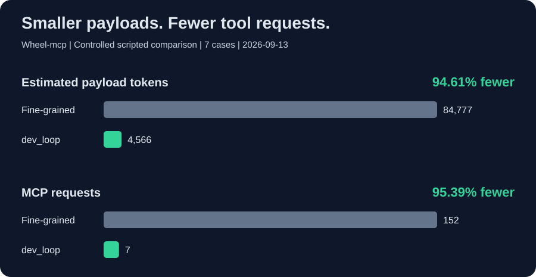

<p align="center"></p>

# Wheel-mcp

**English** | [简体中文](README.zh-CN.md)

> Godot MCP server for AI-assisted game development. Run games, inspect state, and verify every change.

Wheel-mcp connects **Codex, Cursor and other Model Context Protocol (MCP) clients**
to real Godot projects and game runtimes. Use it for **GDScript debugging, runtime
testing and AI-assisted game development**: inspect scenes and runtime state,
send inputs, read diagnostics, and verify changes with assertions, logs and screenshots.

Your assistant writes the code. Wheel-mcp runs the checks and returns evidence.
Client setup adapters are available; form approval and end-to-end compatibility
depend on the client version. See [client compatibility](docs/AGENT-COMPATIBILITY.md).

**Windows local stable · Godot 4.7.2 · MCP · MIT application code**

[Website](https://evedensity.github.io/Wheel-Mcp/) · [Quick start](#quick-start) · [Documentation](docs/README.md) · [Latest download](https://github.com/EVEDensity/Wheel-Mcp/releases/latest) · [Contributing](CONTRIBUTING.md)

If this helps your Godot workflow, **give it a Star**. Bug reports, reproducible examples, and focused PRs are just as welcome.

## Token and interaction efficiency

**Fewer tool exchanges. Leaner context.** In a seven-case test, `dev_loop` reduced estimated payload tokens by **94.61%** and MCP requests by **95.39%** compared with a fine-grained workflow.



Use `responseMode: "compact"` for concise results and `dev_loop` to combine actions, assertions, and screenshots into one verification call.

Seven controlled cases on 2026-09-13; payload tokens estimated as JSON characters / 4, not billable tokens or runtime speedups.

[Test report](docs/REPAIR-BENCHMARK-2026-09-13.md) · [Reproduce](benchmarks/README.md)

With a real `GODOT_PATH`, `npm run benchmark:comparison` reproduces three alternating-order one-shot/persistent SDK query pairs. It records end-to-end time, engine starts, tool calls and serialized bytes, retaining every pair. Actual tokens, billing and whole-workflow efficiency are not measured; these results must not be mixed with the historical estimates above.

## Why Wheel-mcp?

| Workflow               | What the server provides                                     |
| ---------------------- | ------------------------------------------------------------ |
| Explore a project      | Scene, script, and resource discovery                        |
| Inspect a running game | Persistent runtime sessions and property inspection          |
| Check behavior         | Inputs, events, physics-frame waits, and explicit assertions |
| Diagnose failures      | Engine diagnostics, runtime logs, and failure evidence       |
| Verify a change        | Screenshots, comparisons, and evidence artifacts             |

**The client plans and writes code; Wheel-mcp executes bounded Godot operations and reports evidence.** This project is not an autonomous game generator, model provider, or replacement for your coding assistant.

## Current status

The **[local stable release](https://github.com/EVEDensity/Wheel-Mcp/releases/latest)**
targets Windows, Godot 4.7.2 and trusted local projects over stdio. Each release
includes the runtime package, SBOM, checksums and its source-bound acceptance receipt.
The historical [v0.2.0 receipt](docs/releases/0.2.0-windows-local-final.json)
covers that frozen release, not later commits on main.
See the [local release scope](docs/LOCAL-STABLE-RELEASE.md).
Long-session/high-load performance, public HTTP, other platforms/clients and
advanced authoring are outside this stable profile. Automated approvals are
explicit test doubles, not human desktop UX certification. Full production
qualification remains **NOT_QUALIFIED**; T31–T35/G4–G6 remain future work, not
completed tasks. Daily CI runs short Windows push/PR checks. The separate
[release workflow](docs/GITHUB-RELEASE.md) runs bounded real-engine/package
acceptance only for version tags or explicit dispatch. No npm version is published.

Godot runs project code with your OS permissions; headless operation is not a
sandbox. Configure explicit project/evidence roots and use only trusted local
projects. HTTP non-loopback binding is disabled. MIT applies to application code,
not automatically to website media or copied UI sources; see
[third-party notices](THIRD-PARTY-NOTICES.md) before redistributing the full site.

## Quick start

### One-command setup

Use **Windows, Node.js 24 and Godot 4.7.2** for the accepted profile. The server
requires Node.js >=20.19.0; source development also needs the current toolchain.
Clone the release tag for a reproducible starting point:

```bash
git clone --branch v0.2.8 https://github.com/EVEDensity/Wheel-Mcp.git
cd Wheel-Mcp
npm.cmd run go:global
```

Global setup also includes project configuration. It installs dependencies,
builds, detects Godot and updates supported client entries. Existing JSON entries
retain their environment, roots/scopes and client settings; changed JSON and
`.env` files are backed up before writing. Malformed JSON is left unchanged.
Keep backups private because they may contain credentials. The installer configures
the Wheel-Mcp checkout, not every separate game workspace.

Restart your client and call `get_godot_version` to verify the connection.

**Before opening your own game**, set explicit project/evidence roots in the
server environment. Follow the [first-project guide](docs/GETTING-STARTED.md)
for a read-only starting configuration and [troubleshooting](docs/TROUBLESHOOTING.md)
if the client cannot connect. Download from GitHub Releases or build from source;
this release was not published to npm.

- **Windows shortcut:** double-click [install.cmd](install.cmd) for project setup; use the global command for Codex. If PowerShell blocks npm, use `npm.cmd`.
- **Godot not found:** set `GODOT_PATH=/absolute/path/to/godot` in the repository's `.env` and retry. Setup updates this file when Godot is detected.
- **Start the service only:** after installation, `npm run mcp` starts the MCP service, not a game.

### Manual installation and client configuration

Use the following as an alternative to one-command setup.

#### 1. Build from source

Install Godot and Node.js **>=20.19.0**; also satisfy the installed development toolchain's requirements. On Windows:

```powershell
git clone https://github.com/EVEDensity/Wheel-mcp.git
cd Wheel-mcp
npm.cmd ci
npm.cmd run build
```

#### 2. Connect your client

Replace every example path with your own absolute path. Merge these entries into existing configuration rather than overwriting it.

<details>
<summary>Cursor configuration</summary>

Use your game's workspace `.cursor/mcp.json`:

```json
{
  "mcpServers": {
    "wheel-mcp": {
      "command": "node",
      "args": ["D:/tools/Wheel-mcp/build/src/mcp-server-sdk.js"],
      "env": { "GODOT_PATH": "D:/tools/Godot_console.exe" }
    }
  }
}
```

</details>

<details>
<summary>Codex configuration</summary>

Use `~/.codex/config.toml`:

```toml
[mcp_servers.wheel-mcp]
command = "node"
args = ["D:/tools/Wheel-mcp/build/src/mcp-server-sdk.js"]

[mcp_servers.wheel-mcp.env]
GODOT_PATH = "D:/tools/Godot_console.exe"
```

</details>

#### 3. Check the connection

Reload your client and ask it to call `get_godot_version`. If Node is not on the client's PATH, use its absolute executable path.

## Examples

### Background operation without repeated windows

MCP `launch_project` and `open_runtime_bridge` default to `headless: true`: logic,
physics, input and state checks run without a game window. Open one runtime bridge,
then reuse its returned `session_id` as `sessionId` for subsequent
`call_runtime_bridge` requests; stop it when finished. Do not reopen the bridge for
every query. Existing editor tools connect to an authorized editor; they do not
launch another editor.

Screenshots still need a real renderer, not a dummy/headless framebuffer.
`capture_runtime_screenshot` and screenshot-enabled `dev_loop` now start off-screen
and minimize an unfocusable render window. A taskbar entry may remain; OS/driver
startup or error dialogs are not suppressed. This is not a promise that arbitrary
project scripts can never request another window or change focus during startup.
For repeated screenshots use `open_runtime_bridge` with `headless: false,
background: true` and reuse its session. Request `headless: false, background: false`
only for an intentional visible preview. One-shot screenshots still use a separate
process; existing headless sessions cannot be converted to rendered ones in place.
Restart the MCP server after updating to load the new code/bridge. CLI/core launch
defaults are unchanged; use `--headless true` for CLI background launches.

GitHub CI is enabled for pushes and pull requests to main. Pages publishes the
existing showcase. A separate tag/manual release workflow packages and publishes
only after its bounded acceptance passes; none of these workflows publishes to npm.

The retained Windows workflow runs `npm run check`
(one build, style/lint, core MCP transport, approval/transaction safety and site
checks). Dependency auditing runs on manifest/lockfile changes, unknown diffs or
manual dispatch; obsolete runs are cancelled. In Actions, manually enable
`engine` to add the short headless Godot smoke. No automatic engine matrix,
release gate, full regression or soak runs; failure diagnostics expire after
seven days. CI passing is not release qualification.

Use `npm run check` for daily work, `npm run check:full` for full regression,
and `npm run test:godot-ci` for the small native smoke. `npm test` still runs all
tests. `npm run release:gate -- --plan` previews the bounded acceptance steps
without running them or publishing. Follow the [GitHub release procedure](docs/GITHUB-RELEASE.md)
for version tags, artifacts and failure recovery.

Try asking your connected client:

> Inspect this scene and check whether Camera2D is enabled at runtime.

> Run the test scene, send input, and collect logs and a screenshot. Report failed assertions with evidence.

> After applying this patch, run the same checks again and compare the results.

These are client workflow examples, not guarantees of autonomous completion. See the [tool catalog](docs/TOOL-CATALOG.md) for actual interfaces.

<details>
<summary>Reproduce the bundled runtime check</summary>

From the repository root, import the fixture first:

```powershell
$env:GODOT_PATH = 'D:/tools/Godot_console.exe'
$repo = (Get-Location).Path
& $env:GODOT_PATH --headless --path "$repo/tests/fixtures/runtime-behavior" --editor --import
```

Then ask the connected client to call `dev_loop` with the following arguments, replacing the repository prefix. This is a minimal state/physics fixture, not a polished game demo.

```json
{
  "projectPath": "D:/games/Wheel-mcp/tests/fixtures/runtime-behavior",
  "bridgePath": "D:/games/Wheel-mcp/godot-plugin/runtime_bridge.gd",
  "evidenceDir": "D:/games/Wheel-mcp/runs/readme-smoke",
  "scenePath": "res://main.tscn",
  "actions": [{ "method": "wait_physics_frames", "params": { "frames": 12 } }],
  "checks": [
    {
      "id": "camera-enabled",
      "method": "get_property",
      "params": { "nodePath": "Camera2D", "property": "enabled" },
      "path": "value",
      "op": "equals",
      "expected": true
    }
  ],
  "screenshot": true,
  "maxRetries": 0,
  "timeoutMs": 30000,
  "responseMode": "compact"
}
```

Expected result: PASS, zero diagnostic errors, and a 320 × 180 screenshot. The README smoke test reads these arguments directly; an engine test that is skipped is not a successful runtime validation.

</details>

## Know the boundaries

- Runtime property changes do **not** imply a saved editor scene. Optional editor tools require a separately authorized running editor and support only their declared native types. See the [editor bridge contract](docs/production-roadmap/EDITOR-BRIDGE-CONTRACT.md).
- Project-file writes normally require the client's separate form confirmation of the exact transaction. `approved: true` is not permission. Clients without form support fail closed unless a separate, exact local preauthorization policy is configured; do not disable approval checks. See the [transaction contract](docs/production-roadmap/TRANSACTION-CONTRACT.md).
- Persistent sessions and one-shot runs use separate instances; do not assume they share state.
- Only run trusted projects. Project scripts execute code; this server is not an operating-system sandbox.
- Advanced 3D, animation, and shader workflows are not advertised as complete. See the roadmap before depending on them.

<details>
<summary>Editor authoring: implemented subsets and important gaps</summary>

Declared scene operations cover node creation, deletion, rename, reparenting, controlled instantiation and inheritance overrides. A batch is one native Godot Undo/Redo action; saving requires separate exact approval. Save checks reload the actual native staged bytes, and tests also close and reopen the editor. The product does not automatically reload the live document.

- **Scenes and resources:** at most 32 operations per batch, 100 nodes per scene and 14 declared resource types. Documents containing scripts, undeclared node classes or unique-name nodes are not supported by native batches. Inherited scenes require explicit bounded overrides. Approved `.tscn` file writes are not native editing or native undo.
- **UI:** basic controls, containers, Theme/StyleBoxFlat and limited `pressed → hide/show` connections. Not all common controls such as LineEdit/ScrollContainer, arbitrary script callbacks or font resource graphs.
- **3D and physics:** basic transforms, meshes, static collisions, Area3D, RayCast3D and bounded shape queries. Not complete character/rigid-body authoring, skeletal workflows, navigation baking or contact-event history.
- **Animation:** local 2D/3D position keys, bounded state machines and two-source Blend2. Rotation/scale, skeletal, audio and method tracks, and in-place imported-animation editing are not supported.
- **Materials and shaders:** basic material fields, fixed shader text templates and bounded Color/Mix graphs. Not arbitrary shader source or complete PBR/VisualShader editing.

Advanced authoring remains experimental under the [local release profile](docs/LOCAL-STABLE-RELEASE.md). Completed T12–T21 records describe historical acceptance of their declared subsets, not completion of both roadmap directions below. See the [UI](docs/production-roadmap/UI-AUTHORING-CONTRACT.md), [physics](docs/production-roadmap/PHYSICS-3D-CONTRACT.md), [animation](docs/production-roadmap/ANIMATION-AUTHORING-CONTRACT.md) and [shader](docs/production-roadmap/SHADER-AUTHORING-CONTRACT.md) contracts.

</details>

## Major roadmap

The limited local release is available. The following work extends its scope;
existing bounded editor/semantic implementations are not promises of complete
authoring support. See the [implementation plan](docs/PRODUCTION-MAIN-ASSISTANT-ROADMAP.zh-CN.md)
and [task state](docs/production-roadmap/tasks.json) for individual acceptance records.

- [ ] **Reliability beyond the local profile:** long-session/high-load and independent-machine installation checks.
- [ ] **Broader editor-native editing:** expand bounded scene/resource operations while retaining native undo and safe save/reopen verification.
- [ ] **Broader Godot workflows:** bounded, tested support for UI, 3D, animation, materials, shaders, and physics.
- [ ] **Project intelligence and context:** semantic resource indexing, structured Resources/Prompts, and predictable context budgets.
- [ ] **Client compatibility and verification:** Codex/Cursor integration tests, reproducible operation sequences, external patch validation, and regression evidence.
- [ ] **Production reliability and safety:** cross-platform validation, installation/upgrades, long-running stability, permission boundaries, and failure recovery.

## Contributing

Help with reproducible bugs, real-engine/client testing, documentation, translations, or authorized demos. For a larger change, open an Issue to agree on scope before implementation. Keep PRs focused and include a minimal fixture when possible.

```powershell
npm.cmd run check
```

Engine-related changes also need real Godot tests with `GODOT_PATH` configured. Include versions and sanitized logs in reports. Never commit secrets, private project content, or assets without permission. Read [CONTRIBUTING.md](CONTRIBUTING.md) before starting.

## Documentation

- [Documentation index](docs/README.md) and [first-project setup](docs/GETTING-STARTED.md)
- [Troubleshooting and support](docs/TROUBLESHOOTING.md)
- [Tool catalog](docs/TOOL-CATALOG.md)
- [Feature status, limitations and proposed priorities (Chinese)](docs/FEATURE-STATUS.zh-CN.md)
- [Development loop](docs/DEV-LOOP.md)
- [Client repair protocol](docs/CLIENT-REPAIR.md)
- [Deployment](docs/PRODUCTION-DEPLOYMENT.md) and [security boundaries](docs/SECURITY-THREAT-MODEL.md)
- [Implementation roadmap (Chinese)](docs/PRODUCTION-MAIN-ASSISTANT-ROADMAP.zh-CN.md)

## License

[MIT](LICENSE). Independent community project; not an official Godot, OpenAI, or Cursor product.

**Star to follow progress. Fork and open a PR to help build it.**

## Project website

[Open the existing project showcase](https://evedensity.github.io/Wheel-Mcp/).
It introduces the product; browser demos do not connect to your local MCP server.
The static website and browser playground live in `docs/`. Run
`npm run site:serve` and open `http://127.0.0.1:4173/Wheel-mcp/`.
Run `npm run site:test` for static-link and game-logic checks.
See [website setup and game integration](docs/WEBSITE.md).

By [EVEDensity](https://github.com/EVEDensity).
