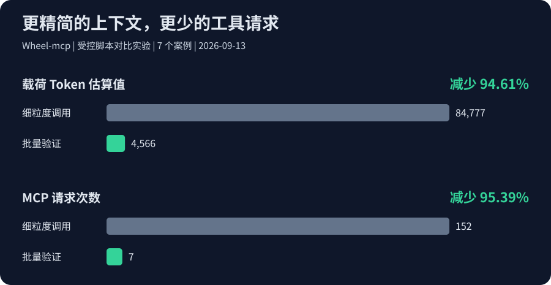

<p align="center"></p>

# Wheel-mcp

**简体中文** | [English](README.md)

> 面向 AI 辅助游戏开发的 Godot MCP Server：运行游戏、检查状态、验证每一次修改。

Wheel-mcp 将 **Codex、Cursor 及其他 Model Context Protocol（MCP）客户端**
接入真实的 Godot 项目与游戏运行时，服务于 **AI 辅助游戏开发、GDScript 调试和运行时测试**。
让助手检查场景与运行时状态、发送输入、读取诊断，并通过断言、日志和截图验证修改。

**助手负责写代码，Wheel-mcp 负责运行检查、返回证据。**
安装器提供客户端配置适配；表单审批与端到端兼容性仍取决于客户端版本，
详见[客户端兼容性](docs/AGENT-COMPATIBILITY.md)。

本项目不是自动生成整款游戏的 Agent，也不是官方 Godot、Codex 或 Cursor 产品。

[](https://godotengine.org/) [](https://modelcontextprotocol.io/) [](LICENSE) [](#当前状态)

[项目展示页](https://evedensity.github.io/Wheel-Mcp/) · [快速开始](#快速开始) · [文档中心](docs/README.md) · [下载最新版本](https://github.com/EVEDensity/Wheel-Mcp/releases/latest) · [参与贡献](CONTRIBUTING.md)

如果它对你的 Godot 工作流有帮助，欢迎点一个 **Star**，也欢迎提交问题、测试报告和 PR。

## Token 与交互效率

**更少的工具往返，更精简的上下文。** 通过 7 个案例的测试实验，`dev_loop` 相比细粒度调用流程，载荷 Token 估算减少 **94.61%**，MCP 请求减少 **95.39%**。



使用 `responseMode: "compact"` 获取精简结果，用 `dev_loop` 将动作、断言和截图组织为一次验证调用。

统计口径：2026-09-13 的 7 个受控案例，以 JSON 字符数 ÷ 4 估算载荷 Token，不代表实际账单或运行加速。

[测试报告](docs/REPAIR-BENCHMARK-2026-09-13.md) · [复现步骤](benchmarks/README.md)

另可在配置真实 `GODOT_PATH` 后运行 `npm run benchmark:comparison`，复现 3 组交替顺序的逐次启动/持久 SDK 会话对照。记录端到端耗时、引擎启动、工具调用与序列化字节，保留每组结果；不测量实际 Token、账单或完整开发工作流，不能与上述历史估算混用。

## 为什么值得试

- 搜索场景、脚本和资源，减少在大型项目中翻文件的时间。
- 读取真实运行时属性，发送输入和事件，辅助验证 2D 游戏行为。
- 捕获诊断、日志、截图和断言结果，而不是只返回“看起来成功”。
- 为 Codex/Cursor 提供稳定的工具边界，让 AI 修改后能够立即验证。

## 当前状态

**[本机稳定版](https://github.com/EVEDensity/Wheel-Mcp/releases/latest)**采用
**Windows + Godot 4.7.2、可信本地项目、stdio 的限域稳定版范围**。
每次 Release 附运行包、SBOM、校验值与对应源码的验收记录。
历史 [v0.2.0 验收记录](docs/releases/0.2.0-windows-local-final.json)只覆盖该冻结版本，
不自动覆盖 main 后续提交。
详见[本机稳定版范围](docs/LOCAL-STABLE-RELEASE.md)。
长时间与高负载性能、线上 HTTP、其他平台/客户端及高级创作能力不属于此次稳定承诺。
自动化验收的审批为明确的测试替身，不代表真人桌面审批体验已认证。完整生产资格仍为
**NOT_QUALIFIED**，T31–T35/G4–G6 保留为后续工作，不标记完成。公开仓库的 CI 自动执行
短时 Windows push/PR 检查。[独立发布流程](docs/GITHUB-RELEASE.md)仅在版本标签或
手动触发时执行有时限的真实引擎和安装包验收，不发布 npm。

Godot 会以本机权限执行项目代码，后台无窗口不是安全沙箱。应显式限制项目与证据
目录，仅操作受信任项目。当前 HTTP 禁止非 loopback 监听。应用代码的 MIT 不自动
覆盖网站视频和复制的 UI 源码，整站再分发前请查看[第三方许可说明](THIRD-PARTY-NOTICES.md)。

## 快速开始

### 一键安装

已验收环境使用 **Windows、Node.js 24 与 Godot 4.7.2**。服务最低要求为
Node.js >=20.19.0，源码开发还需满足当前开发工具链要求。固定发布标签后再安装：

```bash
git clone --branch v0.2.8 https://github.com/EVEDensity/Wheel-Mcp.git
cd Wheel-Mcp
npm.cmd run go:global
```

全局安装也包含项目级配置。脚本安装依赖、编译、查找 Godot，并更新支持的客户端条目。
更新 JSON 客户端条目时保留环境变量、目录限制、权限和客户端设置；改写 JSON 与
`.env` 前备份原文件，异常 JSON 保持不变。备份可能含密钥，请勿公开。项目级配置写在
Wheel-Mcp 仓库目录，不会自动写入其他游戏工作区。

安装后重启客户端，调用 `get_godot_version` 验证连接。

**连接自己的游戏前**，请在服务环境中显式设置项目和证据目录。
[首次接入指南](docs/GETTING-STARTED.zh-CN.md)提供只读起步配置，
[常见问题](docs/TROUBLESHOOTING.md)用于排查连接、权限和后台运行问题。
通过 GitHub Release 下载或从源码构建；本次没有发布 npm 版本。

- **Windows 快捷入口：** 双击 [install.cmd](install.cmd) 安装项目级配置；Codex 使用上表的全局命令。PowerShell 若拦截 npm，改用 `npm.cmd`。
- **未找到 Godot：** 在仓库 `.env` 中设置 `GODOT_PATH=你的Godot可执行文件绝对路径` 后重试。检测到 Godot 时安装器会更新该文件。
- **仅启动服务：** 安装后运行 `npm run mcp`，启动的是 MCP 服务，不是游戏。

### 手动安装与客户端配置

以下是不用一键脚本时的替代步骤。

#### 1. 安装并构建

```powershell
git clone https://github.com/EVEDensity/Wheel-mcp.git
cd Wheel-mcp
npm.cmd ci
npm.cmd run build
```

#### 2. 配置 Godot

设置 Godot 命令行路径：

```powershell
$env:GODOT_PATH = 'D:/tools/Godot_console.exe'
```

#### 3. 接入 MCP 客户端

<details><summary>Cursor</summary>

将以下内容合并到项目的 `.cursor/mcp.json`，替换路径并重载客户端：

```json
{
  "mcpServers": {
    "wheel-mcp": {
      "command": "node",
      "args": ["D:/tools/Wheel-mcp/build/src/mcp-server-sdk.js"],
      "env": { "GODOT_PATH": "D:/tools/Godot_console.exe" }
    }
  }
}
```

</details>

<details><summary>Codex</summary>

将以下内容合并到 `~/.codex/config.toml`，替换路径并重载客户端：

```toml
[mcp_servers.wheel-mcp]
command = "node"
args = ["D:/tools/Wheel-mcp/build/src/mcp-server-sdk.js"]

[mcp_servers.wheel-mcp.env]
GODOT_PATH = "D:/tools/Godot_console.exe"
```

</details>

所有示例路径均需替换为本机绝对路径。若客户端找不到 Node，请将 `command` 改为 Node 可执行文件的绝对路径。

先调用 `get_godot_version` 检查连接，再让客户端执行具体操作。保留配置备份以便恢复。

## 你可以这样使用

### 后台运行，不反复弹出游戏窗口

MCP 的 `launch_project` 和 `open_runtime_bridge` 默认 `headless: true`，逻辑、
物理、输入和状态检查不显示游戏窗口。只打开一次运行时桥接，后续将返回的
`session_id` 作为 `sessionId` 传给 `call_runtime_bridge`，完成后再停止；不要每次
查询都重新打开。编辑器工具只连接已经授权的编辑器，不会自动另开编辑器。

截图仍需真实渲染，不能把 headless 的空帧缓冲当作截图。
`capture_runtime_screenshot` 和需要截图的 `dev_loop` 默认在屏幕外启动，再将渲染
窗口设为最小化、不可聚焦。任务栏可能保留图标；不抑制系统/显卡驱动的启动或报错
对话框，也不保证任意项目脚本不会在启动阶段主动开窗或切换焦点。
连续截图使用 `open_runtime_bridge` 的 `headless: false, background: true` 并复用会话；
仅明确需要可见试玩时设置 `headless: false, background: false`。
一次性截图仍启动独立进程，已有 headless 会话不能原地变为渲染会话。
更新后重启 MCP 服务以加载新代码与桥接脚本。CLI/底层启动默认值不变，
CLI 后台启动请使用 `--headless true`。

GitHub CI 已启用，main 的 push 和 PR 自动执行短时检查。Pages 发布现有展示页；
独立的标签/手动发布流程通过有时限的验收后才打包、创建 Release；所有流程都不发布 npm。

保留的 Windows 工作流执行 `npm run check`，
只构建一次，检查格式/lint、MCP 通信、审批与事务安全以及展示页。依赖清单、
锁文件变化或无法确定改动范围时才做依赖审计；手动触发时也审计当前漏洞。
旧的排队运行自动取消。在 Actions 手动勾选 `engine`，才追加小规模后台 Godot
冒烟检查。没有自动三平台引擎矩阵、发布门禁、全量回归或长负载；失败诊断只
保留七天。CI 通过不代表发布资格。

日常开发使用 `npm run check`；完整回归显式使用 `npm run check:full` 或
`npm test`；小规模真实引擎检查使用 `npm run test:godot-ci`。
`npm run release:gate -- --plan` 可查看去重后的步骤，不执行验证或发布。
[GitHub 发布流程](docs/GITHUB-RELEASE.md)说明版本标签、产物与失败处理。

- “检查这个场景的节点树，并说明 Camera2D 为什么没有生效。”
- “运行测试场景，发送输入，收集日志和截图；如果断言失败，给出证据。”
- “扫描最近修改的 GDScript，指出诊断错误，并提出最小修复。”

这些是客户端工作流示例，不代表所有客户端版本都已完成兼容性验证。

<details>
<summary>运行内置验证示例</summary>

在仓库根目录先导入测试项目：

```powershell
$env:GODOT_PATH = 'D:/tools/Godot_console.exe'
$repo = (Get-Location).Path
& $env:GODOT_PATH --headless --path "$repo/tests/fixtures/runtime-behavior" --editor --import
```

随后通过已连接的客户端调用 `dev_loop`，使用下列参数并替换仓库路径前缀。

下面的参数由 README 回归测试直接读取；它验证一个最小物理帧状态，而不是展示级 Demo：

```json
{
  "projectPath": "D:/games/Wheel-mcp/tests/fixtures/runtime-behavior",
  "bridgePath": "D:/games/Wheel-mcp/godot-plugin/runtime_bridge.gd",
  "evidenceDir": "D:/games/Wheel-mcp/runs/readme-smoke",
  "scenePath": "res://main.tscn",
  "actions": [{ "method": "wait_physics_frames", "params": { "frames": 12 } }],
  "checks": [
    {
      "id": "camera-enabled",
      "method": "get_property",
      "params": { "nodePath": "Camera2D", "property": "enabled" },
      "path": "value",
      "op": "equals",
      "expected": true
    }
  ],
  "screenshot": true,
  "maxRetries": 0,
  "timeoutMs": 30000,
  "responseMode": "compact"
}
```

预期结果：PASS、零诊断错误以及 320 × 180 截图。测试被跳过不等于真实引擎验证通过。

</details>

## 使用边界

个人维护交付采用 Windows 本机范围、普通托管 CI 和 GitHub 自带令牌，不依赖组织级权限。
见[最终整合与维护清单](docs/PERSONAL-PROJECT-DELIVERY.zh-CN.md)；长期扩展不作为每次发布的强制阻断项。

main 新增 `input.mouse_wheel/v1` 有界原生滚轮：viewport 坐标、四方向、factor 大于 0 且不超过 8。
验证真实 ScrollContainer 响应，不控制系统鼠标；注入被接受不代表控件已消费。

main 继续新增单帧 Sprite2D 的居中、偏移、翻转和受控内嵌 PNG/渐变引用，保留原生撤销及保存重开；
不含任意图片加载、图集分帧、区域、材质或角色脚本。见[精灵契约](docs/production-roadmap/SPRITE-2D-CONTRACT.md)。

- 运行时属性修改不等于保存编辑器场景。编辑器保存需独立授权与精确批准，仅支持声明的原生类型；保存后 Undo 的文档/磁盘冲突会阻止普通文件覆盖。
- 项目文件写入通常需要客户端表单精确批准，`approved: true` 本身不是授权。缺少表单支持时默认拒绝，除非另外配置了精确的本地预授权策略；不要关闭审批检查。见[事务契约](docs/production-roadmap/TRANSACTION-CONTRACT.md)。
- 持久会话与单次运行使用不同实例，不能假设状态共享。
- 仅运行可信项目。项目脚本能够执行代码，本服务器不是操作系统沙箱。
- 复杂 3D、动画和 Shader 工作流尚不能视为完整支持。

<details>
<summary>编辑器创作能力：已实现的子集与主要缺口</summary>

原生场景操作支持声明节点的创建、删除、重命名、重设父节点、受控实例化与继承覆盖；一批操作是一次 Godot 原生 Undo/Redo，保存需另行精确批准。保存前会重新加载原生暂存字节核对内容，测试还会实际关闭、重开编辑器；产品不会自动重载正在编辑的文档。

- **场景与资源：** 每批最多 32 个操作、场景最多 100 个节点；公开 v0.2.8 包限定 14 类资源，main 新增有界 GradientTexture2D 和 ImageTexture，共 16 类。含脚本、未声明节点类型或唯一名称节点的文档不支持原生批量编辑；继承场景仅支持声明的覆盖策略。批准后的 `.tscn` 文件写入不等于原生编辑或原生撤销。
- **UI：** 基础控件、容器布局、Theme/StyleBoxFlat，以及有限的 `pressed → hide/show` 连接。main 开发源码新增有界 LineEdit、ScrollContainer、纯文本 RichTextLabel 和 TextureRect 创作，保留原生撤销及保存重开。TextureRect 支持稳定扩展模式、拉伸/翻转、最多 32×32 的内嵌双色原生渐变及 PNG 快照。PNG 来源须有 SHA-256、最多 16 KiB、非交错 8 位 RGB/RGBA，不能带元数据/色彩配置块；审批绑定原始文件字节，通过后内嵌独立像素，不是动态导入纹理依赖或加载导入缓存。外部导出纹理须明确独占复制。需要宿主/插件配套升级（桥接 0.3.6），尚未包含在公开 v0.2.8 包中。更大或任意图片、SVG、CompressedTexture2D、RichTextLabel 的 BBCode/图片/链接/特效/手动格式栈、脚本回调、IME 和字体资源图仍不在支持范围。
- **3D 与物理：** 基础变换、网格、静态碰撞、Area3D、RayCast3D 和有界形状查询；不包含完整角色/刚体创作、骨骼工作流、导航烘焙或接触事件历史。
- **动画：** 本地 2D/3D 位置关键帧、有限状态机和双源 Blend2；尚不支持旋转/缩放、骨骼、音频、方法轨道或导入动画的原位编辑。
- **材质与 Shader：** 基础材质字段、固定 Shader 文本模板与 Color/Mix 有界图；不支持任意 Shader 源码或完整 PBR/VisualShader 编辑。

高级创作仍属于[本机发布范围](docs/LOCAL-STABLE-RELEASE.md)中的实验性能力。T12–T21 的完成记录仅表示对应声明子集的历史验收，不代表下列两个扩展方向已全部完成。详细边界见 [UI](docs/production-roadmap/UI-AUTHORING-CONTRACT.md)、[物理](docs/production-roadmap/PHYSICS-3D-CONTRACT.md)、[动画](docs/production-roadmap/ANIMATION-AUTHORING-CONTRACT.md)与 [Shader](docs/production-roadmap/SHADER-AUTHORING-CONTRACT.md) 契约。

</details>

## 主要路线图

本机限域稳定版已发布；以下列出扩展方向。已有的受控编辑器与语义实现不代表完整创作能力。
各子项的历史验收与待办见 [实施路线图](docs/PRODUCTION-MAIN-ASSISTANT-ROADMAP.zh-CN.md) 与 [任务状态](docs/production-roadmap/tasks.json)。

- [ ] **超出本机范围的可靠性**：长时间、高负载和独立机器的安装验收。
- [ ] **更广的编辑器原生编辑**：扩展声明的场景、资源操作，保留原生撤销和安全保存/重开检查。
- [ ] **更完整的 Godot 覆盖**：逐步覆盖 UI、3D、动画、材质、Shader 与物理工作流。
- [ ] **语义与上下文能力**：建立资源索引、结构化 Resources/Prompts 和可控上下文预算。
- [ ] **客户端兼容与证据链**：提升 Codex/Cursor 兼容性、固定操作链、补丁验证和回归报告。
- [ ] **生产运维与安全**：跨平台、安装升级、恢复、权限边界和长时间稳定性。

## 贡献

欢迎先提交 Issue 描述场景、Godot 版本、客户端版本和脱敏日志，再提交聚焦的 PR。引擎相关改动请附可复现测试；提交前运行：

```powershell
npm.cmd run check
```

欢迎贡献文档、翻译、真实客户端/平台测试和有授权的演示项目。引擎相关改动还需设置 `GODOT_PATH` 运行真实 Godot 测试，不能以跳过代替通过。

请不要提交密钥、私有项目内容或未经授权的游戏资源。详见 [CONTRIBUTING.md](CONTRIBUTING.md)。

## 文档

- [文档中心](docs/README.md)与[首次接入指南](docs/GETTING-STARTED.zh-CN.md)
- [常见问题与反馈](docs/TROUBLESHOOTING.md)
- [工具目录](docs/TOOL-CATALOG.md)
- [逐项功能现状、限制与后续优先级](docs/FEATURE-STATUS.zh-CN.md)
- [开发循环](docs/DEV-LOOP.md)
- [客户端修复协议](docs/CLIENT-REPAIR.md)
- [生产路线图](docs/PRODUCTION-MAIN-ASSISTANT-ROADMAP.zh-CN.md)

## License

采用 [MIT](LICENSE) 许可。独立社区项目，与 Godot、OpenAI 或 Cursor 无官方隶属关系。

欢迎 Star、Fork 和 PR，一起把 Godot 的 AI 辅助开发做得更可靠。

## 项目网站

[打开现有项目展示页](https://evedensity.github.io/Wheel-Mcp/)。网站用于产品介绍，
浏览器演示不会连接访问者本机的 MCP 服务。
静态官网和浏览器游戏试玩厅位于 `docs/`。运行 `npm run site:serve`，
访问 `http://127.0.0.1:4173/Wheel-mcp/`；运行 `npm run site:test` 检查站内链接与游戏逻辑。
详见[网站部署与游戏接入说明](docs/WEBSITE.md)。

By [EVEDensity](https://github.com/EVEDensity)。
