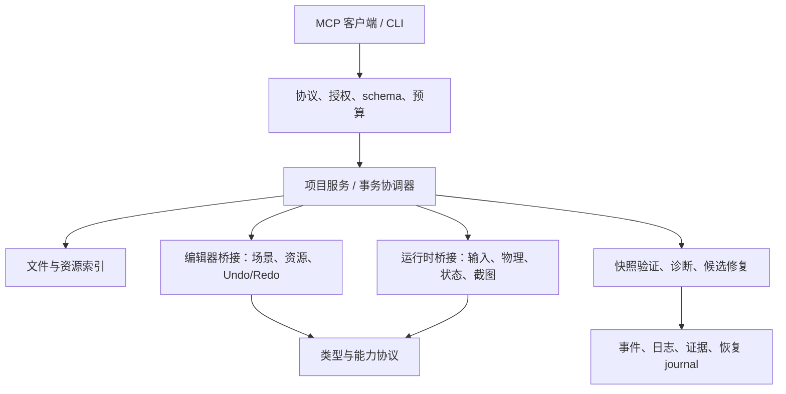

# Wheel-mcp 生产级 Godot MCP 工具服务改造计划与 AI 执行手册

> 文档版本：1.1。制定日期：2026-09-14。
> 当前代码基线：`0.1.0-preview.2`。当前成熟度：可信项目、本机监督使用的辅助工具。
> **本文是待实施计划，不是已经实现的功能清单，也不是生产就绪认证。**
> 目标：在明确的引擎、操作系统、项目类型和权限边界内，为 Codex、Cursor 等 AI 客户端提供可靠的 Godot 操作与验证能力；不承诺任意项目、任意 Godot 版本或无人监督下的无限制自治。

## 0. 项目定位与职责边界

Wheel-mcp 是**面向 Codex、Cursor 等 AI 客户端的 Godot MCP 能力服务器与可验证执行适配器**，不是自主游戏开发 Agent。这是产品定位，不代表各客户端和功能已通过验收；实际支持范围以版本化测试矩阵为准。

- **客户端负责**：理解用户目标、任务拆解、游戏设计、代码生成、修复策略、模型选择、长期记忆与多轮任务编排。
- **本服务负责**：MCP 协议、Godot 编辑器/运行时通信、场景与资源操作、外部补丁校验、引擎诊断、授权执行、事务恢复和可重放证据。
- **不增加第二套编排层**：不新增模型供应商适配器、模型费用管理、任务规划器或对话记忆。已有客户端示例/确定性替身只用于演示协议，不升级为服务器内部 Agent。
- **保留必要静态能力**：文件解析、符号检索、路径安全和受控重构可以不启动 Godot；它们仍属于 Godot 适配服务。不能仅因“不启动引擎”就将其排除。
- **Prompts** 仅解释工具调用、预览/批准/验证和恢复步骤，不承担完整游戏设计或生成。**Resources** 提供项目、节点、资源、诊断和操作事实，不保存 Agent 记忆或任务规划。
- **上下文边界**：客户端提供查询目标、符号或诊断；服务完成有预算的检索，不自行拆解业务任务。
- **状态边界**：运行 session、补丁 ticket、事务 journal 和有界操作状态属于服务；跨任务计划、业务 backlog 和长期 Agent 状态不属于服务。
- **执行边界**：固定操作序列、显式候选补丁、受控语义重构属于工具能力；选择下一开发目标、生成候选、自动调整验收或自主修复循环属于客户端。
- **公开材料**只描述本产品、公开客户端和可验证接口，不记录非公开系统的名称、架构、路径或集成关系。日志、截图、fixture、示例和发布证据也适用。

本路线图是实现 MCP 服务的开发计划，不是产品内置的任务编排系统。面向 Codex/Cursor 是客户端定位，不表示官方出品或官方认证。

## 1. 使用入口与唯一进度来源

本文件定义需求、顺序、设计约束和验收标准。配套文件：

- `docs/production-roadmap/tasks.json`：任务状态、依赖、证据索引；机器可读的唯一进度来源。
- `docs/production-roadmap/WORKLOG.md`：每轮执行、失败、决策和交接记录；只追加，不覆盖历史。
- `docs/production-roadmap/decisions/`：需要时新增 ADR，记录协议或架构决策；当前不要求预先建空目录。
- `runs/production-roadmap/<task-id>/<run-id>/`：实际运行证据；生成目录，遵循仓库忽略规则，不把大日志提交到 Git。
- `.harness/code-audit/`：制定计划前的本机审计结果，仅作线索；新克隆可能没有，不能作为测试唯一依赖。

本文件中的源码路径均相对仓库根目录。执行 AI 应用 `git rev-parse --show-toplevel` 重新获取实际根目录，不硬编码这个机器路径。

阅读顺序：本节 → 第 2 节目标 → 第 4 节 AI 协议 → 当前任务及依赖 → 对应 Gate。

**默认严格按照 T00 → T35 顺序执行。依赖图用来阻止遗漏，不授权并行跳步。**

## 2. “生产级 Godot MCP 工具服务”的可验收定义

### 2.1 必须同时成立的六项承诺

1. **改得对**：类型检查、资源引用、节点路径和属性读回正确；不支持的操作明确失败。
2. **存得住**：编辑器内、磁盘和重启后的结果一致；有脏场景冲突策略和可靠撤销/恢复。
3. **测的是新代码**：验证运行绑定项目快照，旧脚本缓存不能冒充新版本验证。
4. **失败不会装成功**：MCP、桥接、CLI、事件、诊断和证据使用一致语义。
5. **能处理日常复杂任务**：支持 2D/3D、UI、场景实例、材质/物理资源、动画及受限 Shader 图工作流。
6. **规模与权限可控**：有上下文预算、增量检索、明确授权、生命周期约束和审计。

### 2.2 支持范围必须分层发布

| 层级                | 目标范围                                                 | 对外声明条件                       |
| ------------------- | -------------------------------------------------------- | ---------------------------------- |
| L0 当前基线         | 本机可信项目、运行时辅助与修复验证                       | 仍是 preview，不能改称完整生产助手 |
| L1 可靠运行时       | 本机持久会话、可靠类型/错误/事件/新鲜验证                | Gate G1 通过                       |
| L2 安全内容编辑     | 编辑器原生操作、事务、资源持久化与撤销                   | Gate G2 通过                       |
| L3 日常开发主力候选 | 2D/3D/UI/动画/材质工作流、语义索引、预算检索             | Gate G3、G4、G5 通过               |
| L4 生产级 Godot MCP 工具服务   | 冻结范围内的真实项目验证、性能、安全、安装与恢复全部合格 | Gate G6 通过，并发布能力/限制矩阵  |

首个生产范围优先是 **Windows、本机 stdio、可信 GDScript 项目、明确验证过的 Godot 版本**。Linux、macOS、远程 HTTP、C#、复杂自定义编辑器扩展分别标记 VERIFIED / EXPERIMENTAL / UNSUPPORTED / NOT_RUN。未验证的平台或语言不能共享生产标签。

不将“做出所有 Godot 功能”作为完成条件。允许限定支持的 VisualShader 节点族、AnimationTree 图类型，但必须在 schema、能力发现和文档中准确表达；不允许宣称支持然后悄悄退化为空结果。

### 2.3 不在首轮目标中的能力

- 完整替代 Godot IDE、Profiler、所有导出平台与商业插件。
- 对不可信项目提供操作系统级安全沙箱；运行游戏仍会执行本地代码。
- 无批准地部署服务、发布包、购买模型服务或修改任意外部项目。
- 以通过编译代替玩法正确性、美术质量或“好玩”的人工判断。

## 3. 已知事实、缺陷与工程原则

### 3.1 基线事实

2026-09-14 的前序审计记录：官方 SDK 客户端发现 57 个 Tools；Resources/Prompts 未注册；在本机 Godot `4.7.2.stable.official.ed1daf0bf` 上运行现有测试得到 90 PASS、0 FAIL、0 SKIP。**这是历史快照，后续每轮必须重新记录自己实际执行的结果，测试数量不应被硬编码成永久目标。**

现有入口：

| 模块           | 当前文件                                                                                              |
| -------------- | ----------------------------------------------------------------------------------------------------- |
| MCP            | `src/mcp-server-sdk.ts`、`src/mcp/tool-registry.ts`、`src/mcp/tools/*.ts`                             |
| 响应/类型/权限 | `src/mcp/tool-context.ts`、`src/response-types.ts`、`src/error-schema.ts`、`src/mcp/access-policy.ts` |
| Godot 运行     | `src/godot-runtime.ts`、`src/persistent-runtime-bridge.ts`、`godot-plugin/runtime_bridge.gd`          |
| 文件/脚本      | `src/godot-development.ts`、`src/script-analysis.ts`、`src/context-pack.ts`                           |
| 验证/修复      | `src/development-loop.ts`、`src/client-repair.ts`、`src/scenario-executor.ts`                         |
| 生命周期       | `src/runtime-events.ts`、`src/run-registry.ts`、`src/timeout.ts`、`src/process-tree.ts`               |
| 发布           | `scripts/release-gate-local.mjs`、`scripts/test-godot-ci.mjs`、`.github/workflows/*.yml`              |

### 3.2 必须转成永久回归测试的缺陷

| 缺陷 ID | 审计发现                                                                     | 首要任务           |
| ------- | ---------------------------------------------------------------------------- | ------------------ |
| D01     | `set_property`/创建初始属性未统一解码 Vector2，实测传 `(10,20)` 后变 `(0,0)` | T01、T03           |
| D02     | 部分节点不存在错误包在正常 result 中，MCP 没有 `isError`                     | T01、T02           |
| D03     | 持久 JSON-RPC 通知落盘格式与通用事件解析器要求不一致                         | T01、T04           |
| D04     | 重载 `.tscn` 后，修改的脚本变量仍取缓存旧值                                  | T01、T06           |
| D05     | `compact` 丢弃 `get_game_state` 的业务属性                                   | T01、T05           |
| D06     | 旧式读写、输入、截图分别启动新实例，不能共享游戏状态                         | T01、T07           |
| D07     | 写场景仅检查 `[gd_scene` 字符串，非法内容仍返回已保存                        | T01、T09、T14      |
| D08     | `res://` 与操作系统路径在工具间处理不一致                                    | T01、T09           |
| D09     | 3D 不支持的专项查询返回成功空集；静态语义分析只是正则启发式                  | T01、T18、T22      |
| D10     | `call_runtime_bridge` 的 run 权限可间接执行写方法                            | T01、T08           |
| D11     | 通用文件路径检查弱于修复流程；缺少统一真实路径/链接策略                      | T09                |
| D12     | 全量文件、树、历史事件、日志重复返回或重写，缺少总预算                       | T04、T05、T23、T24 |
| D13     | 运行时节点无 owner/pack/save 持久化闭环                                      | T12、T13、T14      |

原则：真实执行过、执行成功、状态正确、持久化正确，是四个不同命题。`source: REAL` 不能替代任何一个验证。

## 4. 后续 AI 的固定执行协议

### 4.1 每轮启动

1. 读取本文件、`tasks.json`、WORKLOG 最近两轮；读取仓库内适用的 `AGENTS.md`，遵守其约束。
2. 运行 `git status --short`，记录用户已有改动；不覆盖、不清理、不回滚与当前任务无关的内容。
3. 确定仓库根目录、Node/npm/Godot 版本、渲染环境、可用空间和目标平台。不要输出 `.env` 全文或密钥。
4. 在排序后任务列表中选第一个非 `done` 的任务。其依赖和前一阶段 Gate 必须满足；否则先解决依赖，不扩大范围。
5. 把选定任务改成 `in_progress`，写本轮目标、允许改动范围和验证命令。默认同一时间只能有一个 `in_progress`。
6. 先阅读当前实现及测试，确认缺陷仍存在；若已被其他改动修复，仍需补回归和证据，不能凭直觉标完成。

### 4.2 每个任务的实施循环

- **先复现，再修改**：添加最小失败用例，记录原代码上的失败原因；不能仅添加永远通过的 schema 测试。
- **最小纵向切片**：优先完成 MCP → 服务 → Godot → 读回/重开 → 证据整个闭环，再扩展相似类型。
- **限制写集合**：只改任务涉及模块、必要测试、工具目录/权限/迁移说明。不顺便全库重构或升级依赖。
- **真实执行与替身分离**：纯协议、网络错误可用测试替身；引擎操作验收必须启动真实 Godot；模型替身不能标成 live model。
- **失败闭合**：未知 schema、权限不足、类型不支持、验证超时、状态不确定均不能返回业务成功。
- **保持迁移路径**：不直接删掉既有工具；兼容包装与弃用记录按第 6 节执行。
- **保存可重放证据**：请求、响应、输入 hash、Godot/Node/OS 版本、日志、退出状态、必要截图、测试命令与退出码。

### 4.3 完成判定与状态更新

任务只有同时满足以下条件才能是 `done`：

1. 本任务所有必需交付项和验收项完成；依赖均 `done`。
2. 定向测试通过；关键反向测试确实验证失败路径；没有把失败断言删掉。
3. `build`、`lint`、格式检查、当前阶段要求的完整测试通过；所需真实引擎/编辑器测试没有 skip。
4. 文档、工具清单、权限表、CLI/MCP 契约和迁移说明按变更更新。
5. 提交到仓库的测试可在新克隆重现；不能依赖仅存于开发者 `.harness` 的文件。
6. `tasks.json` 填入实际证据索引、命令结果与完成时间；WORKLOG 写明修改和残余风险。

不自动 git commit、push、发布 npm 包、改远程服务或建新任务。若运行环境/用户明确授权这些操作，再单独执行并报告。

### 4.4 阻塞、恢复与无人值守边界

- 缺 Godot、渲染器、编辑器会话、网络、外部账号或批准时，写明 **BLOCKED/NOT_RUN**，不可跳过后标通过。
- `tasks.json` 的 `blocked` 是本路线图任务状态，不等同于任何平台 Goal API 的状态。
- 可继续做当前任务不依赖外部条件的代码/纯测试；不能跨过未通过的 Gate 进入下一阶段。
- 崩溃或上下文中断后，先读 WORKLOG 和事务 journal，重新检查磁盘和进程，再继续；不得假定上轮已回滚。
- 不自行解除路径限制、提升作用域、批准真实用户补丁或扩大验收容差来过测试。
- 开发测试在隔离 fixture 上使用显式的测试批准；不得将测试批准复用为用户项目批准。
- 涉及删除用户资产、覆盖脏场景、权限扩张、公共发布、花费资金的操作需要实际用户授权。

### 4.5 每轮最终交接模板

```text
任务：Txx / 标题
状态：done | in_progress | blocked
基线：Git revision/dirty hash、OS、Node、Godot、渲染模式
改动：文件及目的
验证：命令、退出码、PASS/FAIL/SKIP、反向用例结果
证据：路径、可选归档地址、内容 hash
残余：未解决问题、兼容性、恢复要求
下一个任务：Tyy；若阻塞，写明解除阻塞的最小操作
```

## 5. 目标架构与分层约束



- MCP 注册层只负责 schema、授权上下文和路由，不放引擎业务逻辑；保留现有五域注册模式。确需第六域先 ADR。
- Runtime 只改变当前游戏实例；Editor 改变编辑器文档；Project 改变受控项目文件。所有变更必须说明 plane。
- 新增的 `src/protocol/`、`src/project/`、`src/editor/`、`src/index/` 是建议目录，不表示当前已经存在。先做小模块，不一次搬迁全仓库。
- 共用类型转换、错误、资源定位和权限判断；不要为 CLI/stdio/HTTP 各写一份业务实现。
- 索引只提供辅助上下文，不成为资源合法性的最终裁判；最终以对应版本的 Godot 加载和运行验证为准。
- 将任意 `call_method` 视为可能执行项目代码，不把它标成只读。类型只读查询也要避免有副作用的方法。
- 用户代码只在批准的可信项目执行；插件安装/启用本身也是修改项目与执行代码的操作。

## 6. 先冻结的协议与兼容策略

T02 完成前先记录 ADR；以下是协议要求，不要求未经讨论照抄命名。

### 6.1 能力与生命周期

- 握手包含 `protocolVersion`、server/bridge 版本、Godot 精确版本、plane、project identity、session/run ID、支持的类型/方法/图节点族。
- 不兼容协议拒绝建立会话；不支持的引擎能力返回 `UNSUPPORTED`，给可用替代路径。
- 调用结果注明 `lifetime: persistent | one_shot`、`persisted`、`restartRequired` 和影响范围；只在语义适用时出现。
- 会话由创建者持有，pid 必须与启动记录、启动时间/身份绑定；防止 PID 重用误杀。
- `stop` 幂等。请求超时不等于服务端动作取消成功；写操作需操作 ID、幂等键、状态查询和恢复路径。

### 6.2 统一响应与错误

成功：业务数据 + 验证状态 + 证据引用；失败：`status: FAIL`、稳定 `code`、`message`、`retryable`、`details`，MCP `isError: true`。

至少区分：INVALID_ARGUMENT、NOT_FOUND、UNSUPPORTED、FORBIDDEN、CONFLICT、ENGINE_UNAVAILABLE、PROTOCOL_MISMATCH、VALIDATION_FAILED、TIMEOUT、CANCELLED、INTERNAL_ERROR。

- `compact/normal/verbose` 不改变成功/失败和业务语义；compact 可以去掉历史日志、重复元数据，不能去掉请求的属性。
- 不猜测普通字符串是 Vector2/Color；仅显式标签在 Variant 边界解码。
- “文件写入成功”“引擎加载成功”“运行验收成功”分开表达；没有验证时写 `validation: NOT_RUN`。
- 新统一模型如不能无损映射旧响应，新增版本/工具，不在旧字段上静默改变含义。

### 6.3 兼容与弃用

1. 在 T00 保存实际 tools/list、CLI mapping 和返回样本作为基线。
2. 新能力默认增量加入；旧式 one-shot 工具至少保留一个明确记录的迁移周期，具体版本在 ADR 中决定。
3. 旧工具描述明确独立进程生命周期；不得把它悄悄改成操作某个“最近会话”。
4. RPC/schema 改动同时升级 bridge 协议；旧插件握手应报错，不能等到执行时偶发失败。
5. 新增工具必须同步权限、分类、只读/破坏性注解、发现测试、CLI parity 决策与目录。
6. Resources/Prompts 不是生产评级的替代品；只有产生实际检索/工作流价值才注册，并通过官方 SDK 客户端验证。

## 7. 时间与顺序安排

下表为单条实施线的工程量规划，不是自动代理运行时长或承诺交付日期。复杂编辑器事务和跨平台验证可能显著增加工期；T00/T01 后重估一次，不为赶日期削弱 Gate。

| 阶段                | 任务    | 规划工作量   | 里程碑                            |
| ------------------- | ------- | ------------ | --------------------------------- |
| P0 基线与可复现缺陷 | T00–T01 | 3–5 工程日   | G0：基线和反向用例可重现          |
| P1 可信运行时与权限 | T02–T08 | 10–18 工程日 | G1：不再错写、假成功或读旧状态    |
| P2 安全编辑与持久化 | T09–T15 | 18–30 工程日 | G2：编辑、撤销、保存、重开一致    |
| P3 日常内容能力     | T16–T21 | 18–30 工程日 | G3：2D/3D/UI/动画/Shader 纵向流程 |
| P4 语义与上下文规模 | T22–T26 | 14–24 工程日 | G4：可检索、可预算、可增量        |
| P5 MCP 能力与客户端验证   | T27–T30 | 10–18 工程日 | G5：外部补丁与 MCP 客户端契约      |
| P6 性能、分发与发布 | T31–T35 | 12–22 工程日 | G6：冻结范围内生产资格            |

总量约 85–147 工程日；存在跨阶段返工与外部等待，不应换算成“AI 连续跑几天即可完成”。每阶段先交付最小可验证闭环，再扩支持矩阵。

## 8. P0：基线与永久反向测试

### T00 建立可重复基线、任务校验和证据格式

- **依赖**：无。**优先级**：P0。**预计**：1–2 工程日。
- **涉及**：`package.json`、`scripts/test-godot-ci.mjs`、现有测试/工作流；新增 `scripts/verify-production.mjs`、`scripts/check-roadmap.mjs` 和基线 manifest schema。
- **实施**：
  1. 记录 Git revision 与被测源码树 hash、工具 schema 快照、CLI 对照、Godot/Node/OS/渲染器版本；以本机实际结果为准。
  2. 跑现有 build、lint、format、完整测试、真实 Godot smoke，分别记录退出码、PASS/FAIL/SKIP；不可把网络/渲染缺失当成功。
  3. 建立任务/阶段验证入口：`npm run verify:roadmap` 校验任务状态、依赖、Gate 和证据；`npm run verify:production -- --gate Gx` 聚合对应测试与证据。
  4. 验证器读取结构化测试报告，检查退出码及 required suite 的 skipped/cancelled 数；不要只匹配单一终端符号或把未匹配当零。
  5. 定义 run manifest：caseId、taskId、gateId、版本、命令、输入快照 hash、耗时、退出状态、证据 hash、测试替身标识。
- **验收**：同一命令可在新临时项目运行；缺引擎/非法参数/没有渲染时正确失败或 NOT_RUN；非法 done 依赖和缺证据状态被校验器拒绝。
- **测试**：新增 `tests/production-manifest.test.ts`、`tests/roadmap-state.test.ts`；已有 90 项是历史值，不写死这个数量。
- **产物**：基线索引、当前能力矩阵、可复用 gate runner；只新增命令，不宣称后续 Gate 已实现。

### T01 将审计缺陷转为可重放的反向用例

- **依赖**：T00。**优先级**：P0。**预计**：2–3 工程日。
- **涉及**：新增 `tests/production-baseline/`、隔离的临时 Godot fixture、基线验证入口。
- **实施**：
  1. 重建 D01–D10 的最小复现场景，不依赖 `.harness/code-audit`。
  2. 覆盖标签 Vector2 写入、错误节点、事件文件、旧脚本重载、compact、one-shot 状态、非法场景、`res://`、3D unsupported 和 method 权限。
  3. 同时保存正确对照：标量读写、持久状态、真实截图/诊断、正确 Vector2 方法调用。
  4. 每个缺陷用例写“期望正确行为”，而非断言错误行为永远存在。修复前由单独 baseline runner 收集已知失败；不把它们混入必须全绿的默认套件。
  5. 用 `EXPECTED_DEFECT` 描述当前已复现缺陷，绝不把它计为功能 PASS；随着对应 owner task 修复，将对应用例移入必需回归集合（包括 T14 的场景校验和 T18/T22 的能力边界）。
- **验收**：每个缺陷有输入、实际、正确期望、owner task；原代码确实出现预期缺陷，或标记已修复并提供证据；默认已有测试不退化。
- **测试**：通过官方 SDK stdio 客户端到真实 Godot；HTTP 权限另加同场景测试。至少一组合法对照能成功，排除测试环境本身损坏。
- **产物**：缺陷清单和追踪映射。**特殊完成规则**：本任务允许 baseline 中预期失败，但每个缺陷必须在对应修复 Gate 前变为正常通过（G1：D01–D06、D10；G2：D07、D08；G3/G4：D09 的 3D/语义部分）；不得通过 skip/todo 隐藏。

**Gate G0**：基线可重建、缺陷可重放、任务进度可校验。G0 不代表缺陷已解决。

## 9. P1：先让运行时结果可信

### T02 统一错误、结果与桥接协议

- **依赖**：T01。**预计**：2–3 工程日。
- **涉及**：`src/error-schema.ts`、`src/response-types.ts`、`src/mcp/tool-context.ts`、桥接 TS/GDScript、`schemas/`。
- **实施**：
  1. ADR 定义第 6 节错误码、响应版本与兼容包装；建立单一构造和校验入口。
  2. 修复 `get_game_state/get_specialized_state/query_collisions` 的嵌套 error；未知结果形状拒绝，不靠字符串猜测错误。
  3. 区分成功空集与“不支持”、无节点、无属性；保留桥接错误码和必要上下文。
  4. 业务成功必须验证所需返回字段；compact 处理前后状态一致。
  5. 添加桥接协议版本握手和不匹配错误，为后续 editor/runtime capability 扩展留字段。
- **验收**：所有已暴露工具的预期错误均具有稳定错误码；MCP `isError`、CLI exit/status、结构化响应一致；断开连接/非法响应不能返回成功。
- **测试**：新增 `tests/runtime-error-contract.test.ts`，扩展错误/response/matrix 测试；真实节点不存在和已关闭会话必测。

### T03 建立统一 Godot Variant 编解码及属性读回

- **依赖**：T02。**预计**：2–4 工程日。
- **涉及**：桥接两端、`src/response-types.ts`；建议新增 `src/protocol/variant.ts` 和桥接类型辅助模块。
- **实施**：
  1. 先实现 bool/int/float/string/null、Vector2/Vector2i/Vector3/Vector3i、Color、NodePath，再实现 Quaternion/Basis/Transform2D/Transform3D、数组与字典。
  2. `set_property`、`create_node.properties` 和 `call_method.args` 共用解码器；输出共用编码器。
  3. 利用属性/方法元数据校验类型、范围、参数数目；不允许 Dictionary 静默转成零向量。
  4. 明确 JSON 不能直接表示的数值、64-bit 整数、PackedArray、循环对象和非有限数的编码或 UNSUPPORTED 行为。
  5. 读回比较标量/结构值；浮点容差按类型与操作定义，不能使用无界宽容差。Resource 仅允许受控引用，实际解析交给 T13。
  6. 节点批量初始属性预验证；失败时不留下半成品节点。普通文本 `"Vector2(1,2)"` 必须仍是字符串。
- **验收**：D01 变绿；2D/3D transform round-trip 正确；错误类型无副作用且明确失败；未知类不能泄漏实例。
- **测试**：`tests/variant-codec.test.ts`、`tests/runtime-property-roundtrip.test.ts`，真实引擎覆盖每种宣布支持的类型。

### T04 统一事件、游标与长会话日志

- **依赖**：T02、T03。**预计**：2–3 工程日。
- **涉及**：`src/runtime-events.ts`、`src/persistent-runtime-bridge.ts`、`godot-plugin/runtime_bridge.gd`、事件 schema。
- **实施**：
  1. 定义唯一的持久事件 envelope；协议通知在落盘边界规范化，保留 run ID、sequence、时间戳和 payload。
  2. 将 ready/control 通知与游戏事件分开，不把 ready 作为非法游戏事件解析。
  3. 明确 ACK、至少一次投递、去重、重连和 run 切换语义；`wait` 默认等待指定 cursor 后的新事件，历史匹配必须显式选择。
  4. 按偏移增量读取 JSONL，处理部分行、文件轮转、损坏行和游标超前；设置内存环形队列和日志大小上限。
  5. 写日志改为有序追加/缓冲落盘，不每次重写完整 stdout/stderr；stop 等待证据写完。
- **验收**：真实 bridge → events.jsonl → get/poll/ack/reconnect 完整链路通过；无丢失且重复可识别；错误行不吞掉后续合法事件。
- **测试**：`tests/persistent-events-e2e.test.ts`、既有订阅协议测试；至少 10,000 条事件与断连恢复测试，限制内存后仍正确。

### T05 修复 compact，并建立可预算响应

- **依赖**：T02、T04。**预计**：1–2 工程日。
- **涉及**：`src/mcp/tool-context.ts`、各域工具响应、桥接查询输出。
- **实施**：
  1. 按结果类型定义必要业务字段，不再使用一份全局白名单粗暴裁剪。
  2. compact 保留请求的属性/查询条目、状态、错误、截断标识和继续获取的引用；默认不回全部历史事件。
  3. 树查询增加 subtree、depth、fields、limit、cursor；总量限制在数据构造阶段执行，不是构造完再裁掉。
  4. 对日志、事件、大文本采用分页/引用；HTTP 与 stdio 遵循同一预算。
- **验收**：D05 变绿；三个模式业务数据一致；超过预算返回可继续读取的信息而非无声截断；错误仍 isError。
- **测试**：`tests/response-budget.test.ts`；分别测试空结果、大结果、嵌套错误、正常结果和续页一致性。

### T06 新鲜快照验证与引擎能力协商

- **依赖**：T02、T03。**预计**：1–2 工程日。
- **涉及**：`src/godot-path.ts`、桥接启动、`src/development-loop.ts`、reload 工具。
- **实施**：
  1. 启动时验证版本/协议/实际 capabilities；支持范围来自实测配置，不按可执行文件名猜版本。
  2. 区分 scene reload 与代码重新加载；未知资源缓存状态不承诺 hot reload。
  3. 首先把“修改脚本后需要新进程验证”做成可靠默认；如加热重载，必须单独验证依赖闭包及缓存行为。
  4. 记录验证开始前输入 hash，完成后复核输入未变；并发外部修改返回 CONFLICT，不能把混合快照标 PASS。
  5. 覆盖 Autoload、class_name、导入资源、场景依赖和初始化错误；启动成功与脚本加载成功分别判断。
- **验收**：D04 的 health 1→2 必须在声明验证新代码时读取 2；不支持版本返回明确错误；版本未知标 NOT_VERIFIED。
- **测试**：`tests/fresh-validation.test.ts`、`tests/bridge-handshake.test.ts`，含脚本缓存、Autoload 与并发编辑对照。

### T07 统一会话寿命、取消和进程回收

- **依赖**：T02、T04、T06。**预计**：1–2 工程日。
- **涉及**：runtime tools、`src/run-registry.ts`、桥接、`src/process-tree.ts`、场景执行器。
- **实施**：
  1. 所有新状态操作必须显式 session ID；旧 one-shot 工具标注寿命和迁移路径，绝不隐式选择最近会话。
  2. 运行与持久桥接统一登记、配额、所有权和退出记录；防止重复 session ID 覆盖活进程。
  3. 为写请求添加 operation ID/幂等性；超时返回 UNKNOWN/PENDING 状态查询引用，而非让客户端盲目重放。
  4. 取消传播、断连清理、退出诊断和独立 cleanup budget 保持一致；PID 重用不能导致误杀其他进程。
  5. 服务器意外退出后的 reclaim 先验证进程身份；缺身份不能强杀。
- **验收**：同会话输入→状态→截图一致；两会话隔离；双 stop 幂等；超时/取消/客户端崩溃不残留本任务进程。
- **测试**：`tests/session-isolation.test.ts`，扩展 timeout/shutdown/run-registry 与官方客户端 E2E。

### T08 收紧工具、RPC 与会话权限

- **依赖**：T02、T07。**预计**：1–2 工程日。
- **涉及**：`src/mcp/access-policy.ts`、HTTP lifecycle、tool registry、客户端修复协调器。
- **实施**：
  1. 对所有工具做显式权限分类；CI 检测遗漏，不靠默认 admin 掩盖未配置。
  2. `call_runtime_bridge` 按 method 分类；任意 `call_method` 作为执行代码能力，不给 read-only 角色。
  3. 校验所有 session/run/subscription/repair ticket 的所有权；不能从其他会话名称绕过。
  4. 对嵌套参数路径、截图输出、resource 引用做与顶层一致的边界处理；路径实现与 T09 对接。
  5. 可执行文件、bridge 脚本、extraArgs 等执行入口只能来自服务端配置/批准范围；不能由低权限调用任意指定。
  6. stdio 也有明确本地安全策略；“可信本地”不自动等于可写任意路径。
- **验收**：read 不能执行、run 不能借 RPC 改项目/修改状态、write 没有 run 不能执行用户代码；admin 也不能绕过硬路径边界。
- **测试**：`tests/method-authorization.test.ts`；stdio 策略与 HTTP 两客户端攻击面测试，D10 变绿。

**Gate G1**：T02–T08 完成；D01–D06、D10 对应回归正常通过；错误/事件/取消端到端贯通。G1 不宣称静态写文件或复杂内容编辑已安全。

## 10. P2：安全编辑器操作与持久化

### T09 统一项目路径、资源定位和受保护区域

- **依赖**：T08。**预计**：2–3 工程日。
- **涉及**：`src/godot-development.ts`、`src/script-analysis.ts`、`src/mcp/access-policy.ts`、编辑/修复模块；新增 `src/project/paths.ts`。
- **实施**：
  1. 所有工具共用路径解析：project-relative、受支持的 `res://`、经批准的绝对路径；`uid://` 根据真实资源映射解析，不作为普通文件路径拼接。
  2. 校验真实父目录、链接/junction、Windows 大小写/盘符/UNC/ADS、分隔符与不存在目标；拒绝路径穿越和受保护区写入。
  3. 新文件创建逐级验证父目录，不为不合法路径先创建文件夹；`.git/.godot/.harness` 等内部目录使用独立受控策略。
  4. 对读取与写入采用清晰不同的规则，但都不能越权；输出证据路径单独授权。
  5. 明确检查与使用之间竞态的防护上限；无法可靠防护的远程模式保持禁用，不能声称字符串检查等于沙箱。
- **验收**：D08、D11 覆盖的所有入口统一；合法 `res://` 可读写；各种穿越/链接变体不能改变外部文件。
- **测试**：`tests/project-path-policy.test.ts`；针对 Windows 真实 junction 和可用平台 symlink，不能把必需平台测试 skip 后给该平台 VERIFIED。

### T10 项目事务、审批与崩溃恢复 journal

- **依赖**：T09。**预计**：3–5 工程日。
- **涉及**：`src/development-loop.ts` 的 `ProjectEdits`、`src/client-repair.ts`、文件写入服务；新增 `src/project/transactions.ts`。
- **实施**：
  1. 定义 prepare/dry-run、approve、apply、validate、commit/rollback 状态机；审批绑定操作集、目标和输入 hash，不仅是任意 `approved:true`。
  2. 提取现有精确编辑能力，增加文件创建、受限删除、重命名；默认生成差异和影响清单。
  3. 项目级锁/租约、expected hash、operation ID、幂等重放；外部修改必须冲突而非覆盖。
  4. staging + journal + 备份 + 可恢复替换；多文件不宣称文件系统原子提交，明确中断后的恢复状态。
  5. 恢复时按已应用步骤与 hash 决定前滚/回滚；用户新改动保留为 conflict，禁止一律恢复旧备份。
  6. 生命周期终止时先收敛事务再释放锁；审计不记录密钥或未授权文件内容。
- **验收**：第二个文件失败、磁盘写入故障、进程被终止、重复请求和并发编辑均不会无记录地损坏项目。
- **测试**：`tests/project-transactions.test.ts`、`tests/transaction-recovery.test.ts`；在事务每个持久状态注入故障并重启恢复。

### T11 建立受控 EditorPlugin 桥接

- **依赖**：T03、T06、T08、T09、T10。**预计**：3–5 工程日。
- **涉及**：新增 `godot-plugin/addons/wheel_mcp/plugin.cfg`、`plugin.gd`、桥接模块，`src/editor/editor-bridge.ts`；保留现有 runtime bridge。
- **实施**：
  1. 插件作为独立 editor plane，握手确认编辑器、项目、版本、会话、支持能力与用户授权；默认只监听 loopback。
  2. 连接令牌或等价会话认证；不得接受“第一个连接者”而没有身份校验。禁用插件时清理连接与待处理任务。
  3. 通过已验证的 EditorInterface 等公开 API 读取当前编辑场景、脏状态、选择项、文件系统状态；不要依赖私有 Inspector 实现。
  4. Godot 编辑器主线程执行操作；排队并明确 busy/cancel/timeout 语义。
  5. 未打开编辑器返回 ENGINE_UNAVAILABLE；不悄悄启动另一个游戏实例冒充 editor。
  6. 为临时 fixture 实现安装/启用测试流程；不自动修改用户现有 project.godot 的插件列表。
- **验收**：真实编辑器可连接、可读取场景；连接错项目/错版本/错令牌失败；插件禁用后无残余监听。
- **测试**：`tests/editor-bridge-e2e.test.ts`；既有 runtime E2E 必须仍通过，两 plane 不共享错误身份。

### T12 编辑器场景树操作、owner 与 Undo/Redo

- **依赖**：T10、T11。**预计**：3–5 工程日。
- **涉及**：EditorPlugin 的 scene service、`src/editor/scene-service.ts`、必要 MCP 注册/schema。
- **实施**：
  1. 创建、删除、重命名、重父级、实例化场景、连接/断开 signal；操作前检查名称冲突、路径和引用影响。
  2. 明确 owner 设置规则，区分当前场景、本地子资源和外部实例边界；不随意展开/覆盖导入资源。
  3. 使用对应 Godot 版本可用的 EditorUndoRedoManager/公开编辑 API，单个逻辑批次成为一个可撤销操作。
  4. 节点重命名/移动时处理受支持的 NodePath/连接引用；不能保证的引用提前列为冲突，不能靠字符串全局替换。
  5. 受保护的继承/实例根节点需显式操作策略，不能产生不合法编辑器文档。
- **验收**：嵌套 2D/3D 节点增删改后，Undo/Redo 恢复节点、属性、owner 和 signal；失败批次不留下节点。
- **测试**：`tests/editor-scene-operations.test.ts`；在真实编辑器操作，不能仅检查生成的 tscn 字符串。

### T13 资源句柄、材质与物理 Shape 持久化

- **依赖**：T03、T09、T10、T11、T12。**预计**：3–5 工程日。
- **涉及**：EditorPlugin resource service、Variant codec、`src/editor/resource-service.ts`。
- **实施**：
  1. 引入受控 ResourceRef/句柄：作用域、类型、project identity、生命周期可验证；不允许客户端 tag 直接加载任意系统路径。
  2. 支持创建/引用/复制资源、属性读写、节点赋值、外部资源与内嵌 subresource 保存；shared 与 make-unique 必须显式。
  3. 第一批覆盖 StandardMaterial3D、ShaderMaterial 基础参数、PhysicsMaterial、常见 2D/3D Shape；后续扩类型需能力声明。
  4. 保存使用 ResourceSaver 等已验证引擎 API；引用与 UID 保持一致；重开后验证资源值及共享关系。
  5. 资源图环、已失效句柄、错类型、只读导入资源清晰报错；不递归展开无限对象图。
- **验收**：两个节点共用材质时修改行为符合 shared/unique 选项；Shape 尺寸、碰撞配置保存重开后正确。
- **测试**：`tests/resource-roundtrip.test.ts`、`tests/resource-sharing.test.ts`，包括资源替换、失效句柄和只读导入拒绝。

### T14 将文件写入接入引擎校验与安全保存

- **依赖**：T09、T10、T12、T13。**预计**：2–4 工程日。
- **涉及**：`writeProjectFile/writeSceneFile`、editor save、场景资源图服务、工具迁移包装。
- **实施**：
  1. 对 `.tscn/.tres/.gd` 等受支持资源实行 staging、引擎校验、确认保存的流程，移除“出现标记即合法”的判断。
  2. 验证在正确的项目资源上下文中进行；可使用隔离项目快照或专用验证进程，不能把临时路径当真实 res:// 导致假失败。
  3. 若允许纯文本原样保存，必须显式 `validation: NOT_RUN`、风险提示和相应批准，不能伪装成已验证内容。
  4. 编辑器有未保存改动时，文件工具拒绝覆盖并返回脏文档冲突；用户明确选择后才能保存/重载。
  5. 保存场景通过引擎 pack/save，校验 owner 和资源依赖；通知文件系统更新并等完成确认，不靠固定 sleep。
  6. 给旧工具增加安全迁移说明和预览接口，避免突然改变既有数据格式。
- **验收**：D07、D13 闭环解决；非法场景和脚本不会覆盖原件；新建文件有效；外部文本编辑和编辑器脏场景不会互相覆盖。
- **测试**：`tests/validated-project-write.test.ts`，包含导入资源、UID、非法引用、多文件失败恢复和保护目录。

### T15 编辑—撤销—保存—重开完整验收

- **依赖**：T11、T12、T13、T14。**预计**：2–3 工程日。
- **涉及**：新增小型 editor acceptance fixture 与脚本、G2 gate 配置。
- **实施**：
  1. 用 MCP 创建含 UI、2D/3D 子树、实例场景、材质和碰撞体的项目切片。
  2. 修改 → Undo → Redo → 保存 → 关闭编辑器与运行时 → 重开 → 查询及截图。
  3. 验证信号、owner、NodePath、外部资源、共享材质、磁盘 diff 与运行行为，不要求 tscn 文本逐字相同。
  4. 注入断连、编辑器关闭、保存失败和用户并发改动，验证恢复与证据。
- **验收**：连续 20 次隔离运行结果一致，无节点/资源/进程泄漏；真实编辑器与重开验证不得用 headless 文件写入替代。
- **测试**：`tests/editor-authoring-e2e.test.ts`；若 runner 无编辑器环境，G2 必须 NOT_RUN，不允许下阶段生产标签。

**Gate G2**：T09–T15 全部完成；路径、事务、编辑器、资源和重开一致性合格。此时才允许宣称可安全持久编辑支持的内容类型。

## 11. P3：从基础编辑走向日常内容生产

### T16 正确处理场景实例、继承与依赖图

- **依赖**：T15。**预计**：3–5 工程日。
- **涉及**：`parseSceneResourceGraph/getSceneTree`、编辑器 scene/resource services。
- **实施**：
  1. 保留静态轻量预览但标注 heuristic；实例/继承的权威结果来自 Godot 解析与编辑器状态。
  2. 不再把“第一个 PackedScene ext_resource”直接当继承根；解析根 instance 与实际继承关系。
  3. 处理外部实例局部 override、editable children、资源 UID、依赖失效与递归图终止。
  4. 场景重命名/移动生成引用影响计划，通过事务更新可可靠定位的引用；不支持的引用返回冲突。
- **验收**：至少三层实例/继承链；override 保存重开不丢失；基础场景变更后实例行为正确。
- **测试**：扩展 `tests/scene-resource-graph.test.ts`，新增 `tests/inherited-scene-roundtrip.test.ts`；包含合法实例不应误判继承的反例。

### T17 UI 布局、主题与信号批量搭建

- **依赖**：T12、T13、T15、T16。**预计**：3–5 工程日。
- **涉及**：editor scene/resource service、新增 UI batch schema/工具或现有受控批操作扩展。
- **实施**：
  1. 支持 Control anchors/offsets、Container 布局、size flags、Theme/样式、可访问名称和 signal 连接。
  2. 布局操作理解 Container 管理的属性，不把被布局系统覆盖的值回读成功当成稳定结果。
  3. 模板只生成可编辑节点/资源，不隐藏不可维护的代码生成器；每次批处理有 preview、undo、save。
  4. 固定 viewport、字体和渲染配置，验证不同分辨率、文本长度和本地化布局。
- **验收**：自动生成设置页/背包界面，按钮事件真实触发，保存重开一致，无明显裁切；人工视觉复核单独记录。
- **测试**：`tests/ui-authoring-e2e.test.ts`；至少三种 viewport 和长文本场景，几何断言与截图共同判定。

### T18 3D Transform、碰撞与导航可观测性

- **依赖**：T03、T13、T15、T16。**预计**：3–5 工程日。
- **涉及**：runtime specialized state、collision query、editor physics resource service。
- **实施**：
  1. 明确支持 Area3D/RayCast3D/CollisionObject3D 等查询，包含坐标空间、layer/mask、shape owner 和查询过滤。
  2. 区分 intersect_shape、ray、接触信号、查询采样历史，不用一个“collision”模糊表达所有语义。
  3. 支持物理帧屏障及查询时序；与物理回调冲突时安全调度，不从任意时刻读写受限 physics state。
  4. 增加 Camera3D、NavigationAgent3D 的只读状态；支持矩阵之外的节点明确 UNSUPPORTED。
  5. 批量创建碰撞体通过事务和资源句柄执行，校验尺寸、transform 和共享资源。
- **验收**：斜面/旋转/缩放层级中命中指定目标且坐标正确；layer/mask 不匹配时不命中；3D 不再成功返回假空集。
- **测试**：`tests/runtime-3d-e2e.test.ts`、`tests/physics-authoring-e2e.test.ts`，包含真实物理帧与重开验证。

### T19 AnimationPlayer 与 AnimationTree 受控编辑

- **依赖**：T13、T15、T16。**预计**：3–5 工程日。
- **涉及**：editor animation resource service、runtime animation state、能力 schema。
- **实施**：
  1. 定义首批支持的 Animation、轨道/关键帧、AnimationLibrary、AnimationTree 状态机和 BlendTree 子集。
  2. 图节点/连线/状态转换使用稳定 ID 与明确 schema，不以人类可读名称作为唯一身份。
  3. 编辑前检查参数、轨道目标、状态名称、入口出口和图合法性；事务内保存与撤销。
  4. 运行查询实际激活状态、参数、播放进度；不能只检查 animation.playing。
- **验收**：创建 idle→walk→attack 的可保存状态机，输入触发指定转换；恢复/重开后相同；非法图不得覆盖现有动画。
- **测试**：`tests/animation-authoring-e2e.test.ts`；关键帧、状态转换、路径失效、循环和共享资源回归。

### T20 ShaderMaterial 与 VisualShader 有界图支持

- **依赖**：T13、T15、T16。**预计**：3–5 工程日。
- **涉及**：editor shader resource service、GPU/渲染诊断映射、图 capability schema。
- **实施**：
  1. 第一批支持 shader 文本、uniform 参数和明确白名单的 VisualShader 图节点族、端口类型与连线。
  2. 握手/发现列出支持的节点和渲染模式，不暗示支持全部 VisualShaderNode。
  3. 图编辑前校验端口与类型，保存后在真实渲染器加载；编译失败保留原材质并记录 shader 诊断。
  4. 预览固定场景和灯光，截图/参数断言评估实际效果；不能用文件存在代替 shader 编译通过。
- **验收**：创建一个可调颜色/纹理混合材质并保存重开；错误连线和错误 shader 必须失败且可回滚。
- **测试**：`tests/shader-authoring-e2e.test.ts`，有渲染环境的必需门禁；renderer 不支持返回明确范围错误。

### T21 资源导入与真实项目内容切片验收

- **依赖**：T16、T17、T18、T19、T20。**预计**：3–5 工程日。
- **涉及**：editor file-system/import service、项目 fixture、G3 gate。
- **实施**：
  1. 支持受控资产复制/导入与进度确认，等待 import 完成，不用固定 sleep；尊重 importer/只读源资产边界。
  2. 组合完成一个 2D UI/战斗切片和一个 3D 交互切片，包含材质、碰撞、导航和动画。
  3. 验证导入失败、缺依赖、重命名引用和重开；自动化断言写在任务实现之前，防止按输出倒写验收。
  4. 明确记录仍不支持的 importer、图节点族、复杂插件和语言。
- **验收**：支持矩阵中的每个单元有真实引擎证据；两种切片均从空项目通过 MCP 创建/修改/运行/持久化。
- **测试**：`tests/content-workflows-e2e.test.ts`，以及 G3 全套聚合；无需宣称对所有真实项目都适用。

**Gate G3**：限定支持范围内的 2D/3D/UI/实例/动画/Shader 工作流全部有端到端证据。未支持图类型和节点明确列出，不能靠通用 call_method 宣称覆盖。

## 12. P4：语义理解与大型项目上下文

### T22 GDScript 语义服务与安全重构

- **依赖**：T06、T09、T10、T11、T16、T21。**预计**：3–5 工程日。
- **涉及**：`src/script-analysis.ts`、diagnostics tools；新增 `src/project/script-service.ts` 和 LSP/引擎适配器。
- **实施**：
  1. 保留正则摘要但明确 `analysisLevel: heuristic`；引入已验证的 Godot language-server/语义接口或等价可靠后端。
  2. 提供 symbols、references、definition、diagnostics；检查后端项目身份、版本、连接状态和请求超时。
  3. 对符号 rename 使用后端 WorkspaceEdit/语义定位生成事务预览，结合 snapshot/hash 验证，不用全局字符串替换。
  4. 重构后验证跨文件引用、场景脚本路径及声明支持的 NodePath；无法理解的动态引用列为人工检查项。
  5. 后端不可用时只允许声明为 heuristic 的只读摘要，不自动退化成“安全重构成功”。
- **验收**：多行函数、命名 enum、class_name、继承、类型声明、字符串/注释中的同名词不会误改；非法脚本确实有语法错误。
- **测试**：`tests/script-semantic-service.test.ts`、`tests/script-refactor-e2e.test.ts`；重构后真实引擎运行及回滚验证。

### T23 增量文件、符号、节点与资源依赖索引

- **依赖**：T09、T16、T22。**预计**：3–5 工程日。
- **涉及**：`src/context-pack.ts`、`searchProject/getProjectInfo`；新增 `src/index/`。
- **实施**：
  1. 定义索引键、project identity、schemaVersion、文件 hash、更新时间和 stale 状态；排除 `.git/.godot/node_modules/runs` 等非任务内容。
  2. 初次扫描后只更新改变文件；watcher 作为加速，不作为唯一正确性来源，提供重扫/一致性校验。
  3. 关联脚本符号、scene 节点、ext/subresource、UID 和反向依赖；不解析大二进制为 UTF-8 文本。
  4. 索引存储先选可测试的简单方案；新增数据库依赖需要 ADR 和性能证据，不能为了架构漂亮提前引入重服务。
  5. 限制文件大小、并发和扫描取消；读缓存命中与 stale 情况显式返回。
- **验收**：创建/修改/删除/重命名、事件丢失后的重扫都正确；两项目索引隔离；取消不会留下声称完整的索引。
- **测试**：`tests/project-index.test.ts`、`tests/index-invalidation.test.ts`，含生成的大目录与二进制资源。

### T24 任务定向 Context Pack 与硬预算

- **依赖**：T05、T22、T23。**预计**：3–5 工程日。
- **涉及**：`src/context-pack.ts`、project tools、客户端修复上下文。
- **实施**：
  1. 输入支持任务意图、起始文件/节点/符号、依赖深度、字段与 maxBytes/maxTokens；只返回相关内容。
  2. 排序策略优先显式目标、错误栈、直接依赖、最近修改；每个片段带来源/版本/行号和裁剪原因。
  3. 若模型 tokenizer 可用按实际 tokenizer 预算；未知时只承诺字节上限，token 数标 estimate，不能伪造精确值。
  4. 对超预算内容给 page/resource 引用；不要因为裁剪而隐去错误或把代码片段当完整文件。
  5. `active_run` 来自真实注册信息或明确 unavailable，而不是固定 null 暗示无运行实例。
- **验收**：同一任务在小项目和大项目中始终遵守预算；找不到目标返回不足信息，不用无关全量文件填充。
- **测试**：`tests/context-budget-e2e.test.ts`，覆盖中文、长单行、多字节、超大日志、循环依赖与 tokenizer 不可用。

### T25 MCP Resources、Prompts 与按任务发现

- **依赖**：T02、T08、T23、T24。**预计**：2–4 工程日。
- **涉及**：`src/mcp-server-sdk.ts`、`src/server-info.ts`；新增 resource/prompt 注册模块，工具目录和客户端测试。
- **实施**：
  1. 注册只读、受权资源，例如项目摘要、场景子树、符号、诊断和证据页；URI 使用不透明项目 ID，不直接暴露任意绝对路径。
  2. 提供有实际输入输出约束的 prompt：实现功能、排查错误、搭建 UI、候选修复验收；模板不得隐含批准或改写验收目标。
  3. 资源列表/模板分页和数据更新策略明确；如果不实现 subscription capability，就不声明支持。
  4. 控制 tools/list 规模：能力分组、明确说明、工具注解、按配置选 profile；不复制大量只换名称的工具。
  5. MCP 功能按安装 SDK 与官方规范核对；使用标准 discovery/read/get 调用，不靠客户端私有行为。
- **验收**：官方 SDK 客户端实际调用 resources/list/read、templates/list、prompts/list/get；跨项目/跨权限 URI 被拒绝。
- **测试**：`tests/mcp-resources.test.ts`、`tests/mcp-prompts.test.ts`；prompt 中外部资源文本保持数据身份，不能产生权限提升。

### T26 大型项目性能与检索质量基线

- **依赖**：T04、T05、T23、T24、T25。**预计**：3–5 工程日。
- **涉及**：新增 `scripts/benchmark-context.mjs`、可生成 corpus、G4 gate。
- **实施**：
  1. 冻结三档数据集：约 1k、10k、50k 文件；小/中/大节点树；长日志/10k 以上事件。生成器 seed 与参数入证据。
  2. 测冷索引、暖查询、增量更新、取消延迟、响应字节、峰值内存和正确率；至少五次重复，区分冷/暖缓存。
  3. 准备不少于 30 个目标检索题，有明确正确文件/符号/节点；不能只测速度不测命中。
  4. 用第 16 节预算和冻结基线判定；若硬件不满足目标，记录失败与方案，不能把失败数据排除后宣称达标。
- **验收**：查询和 Context Pack 有预算、索引一致性测试通过；检索目标命中率至少 95%，且所有权限/截断测试通过。
- **测试**：G4 基准和 `tests/index-scale.test.ts`；50k 项目不需要伪造 50k 真实艺术资产，但不能把生成器测试当真实项目收益证明。

**Gate G4**：语义重构有引擎验证，检索有质量指标，上下文有硬预算，长会话资源消耗可控。

## 13. P5：MCP 能力闭环与客户端兼容性验证

### T27 Godot 操作序列回放与执行证据

- **依赖**：T06、T07、T18、T24、T26。**预计**：3–5 工程日。
- **涉及**：`src/scenario-executor.ts`、`src/development-loop.ts`、input/events/physics bridge。
- **实施**：
  1. 仅执行客户端明确提交的有界操作序列，不规划任务、回放 AI 对话或触发自主修复循环。
  2. 验证绑定输入快照、随机 seed、物理帧、viewport、引擎及渲染器；使用帧/事件屏障而非任意 sleep。
  3. 支持状态、碰撞、诊断、场景切换及视觉断言；记录序列、游标和取消结果。
  4. 冻结断言与容差；明确跨平台物理/渲染差异，不承诺逐 bit 确定性。
- **验收**：固定 fixture 连续 30 次满足关键断言；旧事件不满足新步骤，错误和清理失败不能返回成功。
- **测试**：`tests/scenario-replay-e2e.test.ts`，覆盖输入释放、物理帧、场景切换、超时和取消。

### T28 外部候选补丁的安全应用与验证接口

- **依赖**：T10、T14、T22、T24、T27。**预计**：3–5 工程日。
- **涉及**：`src/client-repair.ts`、`src/clients/repair-workflow.ts`、`src/development-loop.ts`。
- **实施**：
  1. 外部客户端提供候选补丁、允许文件、基线 hash、审批引用和验证计划；服务器不生成候选、不选择模型。
  2. 保留 begin/submit 兼容入口，接入预览、差异、权限、语义编辑和事务；审批绑定精确变更及验收计划摘要。
  3. 多文件、场景、资源修改仅限已验证范围；基线冲突先拒绝，不覆盖并发改动。
  4. 无效候选恢复并读回；超时未知状态可查询，不能自动重新提交非幂等写操作。
  5. 返回结构化诊断与证据，由客户端决定是否再提出候选；服务器不得放宽 oracle、阈值或权限。
- **验收**：正确补丁通过，错误补丁被拒绝或安全恢复；拒绝批准不写入；重复请求幂等或明确拒绝。
- **测试**：扩展 `tests/client-repair.test.ts`，使用固定候选和真实 Godot 验证；替身不冒充客户端实测。

### T29 Godot 能力契约与短操作链验收集

- **依赖**：T17、T19、T20、T21、T27、T28。**预计**：2–4 工程日。
- **涉及**：`benchmarks/production-cases/` 清单、授权 fixture 和固定请求 runner。
- **实施**：
  1. 冻结至少 30 个短链路案例，覆盖节点/场景、UI、3D/碰撞、动画/材质、脚本补丁/诊断五类，每类至少 5 个。
  2. 每例给定确切请求、期望结果、权限、失败对照和恢复要求；不考核系统设计、代码生成或模型规划。
  3. 加入许可证允许且可重现的外部真实项目切片；公开产物不包含非公开项目身份。
  4. 运行脚本只发送固定 MCP 调用，不调用模型；案例包括创建、属性修改、保存、重开、读回等有限链路。
- **验收**：全部 required 案例满足预期；正确对照成功，非法输入按预期失败；关键安全失败为零。
- **测试**：G5 case runner，逐例记录协议、引擎结果、持久化和恢复证据，不输出模型质量评分。

### T30 真实 MCP 客户端兼容性与工具契约评估

- **依赖**：T25、T28、T29。**预计**：2–4 工程日，另计客户端环境与授权等待。
- **涉及**：SDK 集成测试、客户端配置示例、兼容性 runner、`docs/CLIENT-REPAIR.md`。
- **实施**：
  1. 使用官方 MCP SDK 客户端重放 T29 的固定序列，覆盖 initialize、Tools/Resources/Prompts 发现及调用。
  2. 分别在实际 Codex、Cursor 客户端验证配置、发现和代表性读写/验证链路；记录版本与实际请求，不以 SDK 测试替代产品客户端测试。
  3. 测试 schema 错误、权限、业务失败、超时、断开、重连和取消；stdio 为首发必需，HTTP 按声明范围单独验证。
  4. 客户端内部可能使用模型，但服务器不配置模型供应商，不统计模型生成成功率、不新增自主任务循环。需要付费或登录时等待用户批准。
  5. 冻结客户端/传输/操作支持矩阵，公开未测试和不支持项；缺环境标 NOT_RUN，不伪装通过。
- **验收**：SDK 全部 required 固定案例通过；Codex、Cursor 各有真实配置/发现/代表性操作证据才标 VERIFIED；关键安全失败为零。未运行的客户端不得进入生产兼容承诺。
- **测试**：真实 SDK 与产品客户端兼容报告；固定请求与失败对照逐项可追溯，不使用模型评分代替工具契约。

**Gate G5**：固定回放、外部补丁验证、短操作链和客户端兼容全部按声明范围通过；不存在模型质量或完整游戏生成验收要求。

## 14. P6：运行质量、分发与生产发布

### T31 长时间运行、并发、故障注入与安全复测

- **依赖**：T08、T10、T15、T26、T27、T30。**预计**：3–5 工程日。
- **涉及**：生命周期、HTTP、editor/runtime bridge、证据系统；新增 soak/chaos runner。
- **实施**：
  1. 连续 8 小时运行有界混合负载：读、编辑、验证、重载、截图、stop；至少 1,000 次任务循环。
  2. 测两个项目与批准的并发上限，验证会话/事务/日志隔离；达到限额时排队或明确拒绝。
  3. 注入 TCP 半包/断开、客户端死亡、Godot/editor 退出、超时、磁盘满/只读、日志写入失败和服务重启。
  4. 重测路径、方法权限、操作批准、跨会话资源、日志脱敏和令牌轮换。
  5. 不允许为过 soak 而屏蔽引擎错误、泄漏或回收失败；记录性能基线与待查增长。
- **验收**：无项目损坏、越权写入、未记录的未知事务或遗留自有进程；恢复不覆盖用户并发改动；内存/延迟符合第 16 节。
- **测试**：`scripts/soak-production.mjs`、security/chaos 报告；模拟故障与真实进程终止明确分开记录。

### T32 干净安装、插件升级、协议迁移与卸载

- **依赖**：T11、T14、T25、T31。**预计**：2–4 工程日。
- **涉及**：`scripts/install.mjs`、`scripts/setup.mjs`、插件打包、配置迁移与 README。
- **实施**：
  1. 从干净目录验证安装 → 配置 → 插件授权启用 → handshake → 首个场景操作 → 验证。
  2. npm 安装/构建不能悄悄启用用户项目插件或改全局客户端配置；需要明确目标和批准。
  3. 安装包包含桥接共享模块、协议 schema 和版本 manifest；运行时不依赖开发机路径。
  4. 升级检查在途事务、脏编辑器状态和协议兼容，备份配置并支持回退；不让新 server 连旧 plugin 后部分成功。
  5. 卸载只删除本工具创建且身份匹配的配置/插件文件，不删用户资源或其他插件。
- **验收**：fresh install、N→N+1、回滚、重复安装、取消安装、卸载全部通过；N 的具体支持版本写入矩阵。
- **测试**：`tests/plugin-install-upgrade.test.ts`、干净机实际客户端录制/证据；不把本机已有环境冒充干净安装。

### T33 平台、引擎与渲染器支持矩阵

- **依赖**：T31、T32。**预计**：2–4 工程日，另计 runner 等待。
- **涉及**：`.github/workflows/*.yml`、CI 安装脚本、Gate runner 和支持矩阵文档。
- **实施**：
  1. 根据 T00/官方发行信息和实际可用二进制冻结目标版本，不凭文件名或计划日期假定“最新稳定版”。
  2. 首先完成 Windows 全量 editor/runtime/render/security gates；Linux/macOS 仅在运行真实对应测试后标 VERIFIED。
  3. 至少列清 headless/non-headless、渲染后端、mono/GDScript、编辑器/运行时的组合与限制。
  4. Required job 不能通过 skip/todo/continue-on-error 变绿；无 runner 时 NOT_RUN，生产范围不包含该单元。
  5. CI 无费用额度时可先留本地可重放证据，但最终发布范围需要独立干净环境结果，不伪造 hosted CI。
- **验收**：每个宣称支持单元有明确测试 run 和同源码 hash；未验证单元在安装、握手和文档中如实限制。
- **测试**：Windows 全量必需，其他平台按实际发布范围必需；不强行以跨平台全部完成阻塞 Windows 限定首发。

### T34 完善迁移文档、故障恢复与用户操作手册

- **依赖**：T16、T25、T28、T32、T33。**预计**：2–4 工程日。
- **涉及**：README 双语、`docs/TOOL-CATALOG.md`、安全/部署/DEV-LOOP/CLIENT-REPAIR/RELEASE-READINESS 文档。
- **实施**：
  1. 从实际 discovery 生成 Tools/Resources/Prompts 清单，展示 plane、lifetime、权限、类型/引擎范围与返回语义。
  2. 给五类任务写可运行示例：预览、批准、编辑、验证、保存、重开、失败恢复。
  3. 记录旧式 one-shot 迁移、插件升级、脏场景冲突、超时未知操作、事务恢复和事件重连步骤。
  4. 清理历史“稳定生产候选”等容易扩大理解的表述，保留原始历史证据但加日期和范围说明。
  5. README 命令做 smoke，不能文档写了未实现工具或误用 bridge RPC 为顶层 Tool。
- **验收**：新使用者只按文档能完成一个创建/修改/验证/恢复任务；所有示例使用有效 schema，无私有路径。
- **测试**：扩展 `tests/readme-smoke.test.ts`、tool-catalog discovery 校验；文档更新不能替代任何功能 Gate。

### T35 生产候选资格审计与限定范围发布

- **依赖**：T00–T34 全部 done，G0–G5 通过。**预计**：3–5 工程日。
- **涉及**：发布 Gate、artifact 汇总、版本说明；只有用户授权后才执行公共发布。
- **实施**：
  1. 冻结候选源码/依赖和能力矩阵；从干净环境按第 16 节完整验证，证据与候选源码 hash 一致。
  2. 审查业务失败、数据损坏、权限/路径、旧代码验证、事务恢复、内存、泄漏与安装回滚；未解决关键缺陷零容忍。
  3. 汇总 G0–G6、客户端兼容性基准、性能、故障、安全、安装和平台结果，原始失败不能被后续成功覆盖。
  4. 生成 RELEASE-QUALIFICATION：VERIFIED 范围、UNSUPPORTED/EXPERIMENTAL、剩余非阻断项、回滚方法和证据归档。
  5. 先满足技术资格；发布版本号/签名/仓库推送/npm 发布各自按用户批准执行。不把缺少商业认证当个人本地使用的强制条件。
- **验收**：第 16 节无阻断；干净环境重放成功；所有生产声明能追溯到具体测试。可以是“Windows/GDScript/指定引擎范围的生产级 Godot MCP 工具服务”，不能泛称所有版本/平台全支持。
- **测试**：`verify:production -- --gate G6`、独立环境重放和最终状态校验；缺任一必需结果则保留 candidate，不 bump 成生产版。

**Gate G6**：T31–T35 完成，且历史 Gate 的关键测试在最终候选上重跑通过。技术资格与用户批准的实际发布状态分别记录。

## 15. 验证命令与证据执行方法

### 15.1 当前已经存在的命令

以下命令以仓库根目录为工作目录。Windows 使用 `npm.cmd`，避免 PowerShell 将 npm 解析为受限制的脚本。其他平台使用自身可执行入口。先检查依赖是否安装；需要安装时按锁文件使用 `npm.cmd ci`，记录安装副作用、网络访问和退出码，不擅自升级锁文件。

```powershell
git status --short
node --version
npm.cmd --version
npm.cmd run build
npm.cmd run lint
npm.cmd run format:check
npm.cmd test
```

`npm.cmd test` 的成功不等于真实 Godot 测试全部运行。必须读取各测试状态、所需环境和 skip 原因。当前 `format:check` 不覆盖本路线图目录；文档需单独检查：

```powershell
npx.cmd --no-install prettier --check docs/PRODUCTION-MAIN-ASSISTANT-ROADMAP.zh-CN.md docs/production-roadmap/tasks.json docs/production-roadmap/WORKLOG.md
git diff --check
```

真实引擎测试使用经确认的可执行文件，不从文件名推断版本。下方路径是占位符，必须替换，不能原样执行：

```powershell
$env:GODOT_PATH = '<已确认的 Godot 可执行文件绝对路径>'
if (-not (Test-Path -LiteralPath $env:GODOT_PATH -PathType Leaf)) {
  throw '缺少 Godot 可执行文件，不能宣称通过引擎验收'
}
& $env:GODOT_PATH --version
npm.cmd run test:godot-ci
```

当前 `scripts/test-godot-ci.mjs` 仅选取部分 smoke 测试，skip 文本解析也需要在 T00 加固。它不能替代后续 editor、事务、渲染、安全、客户端或平台 Gate。`release:gate`、`release:check` 等已有发布命令同样不自动代表本计划的 G6。

### 15.2 T00 必须新增的命令契约（目前尚未实现）

```powershell
# 以下为未来入口；只有 T00 实现并验证后才能执行。
npm.cmd run verify:roadmap
npm.cmd run verify:production -- --gate G0
# 按阶段替换为 G1…G6；指定 Gate 时验证其前置证据和当前必需套件。
```

要求：

- `verify:roadmap` 仅校验任务状态、依赖、证据引用和文档一致性；允许尚未开始的任务为 todo、Gate 为 NOT_RUN。**不能因未来任务没做完而阻止正常开发。**
- `verify:production` 按 Gate manifest 运行必需套件并生成结构化报告，PASS / FAIL / SKIP / NOT_RUN / EXPECTED_DEFECT 分开统计；不能靠匹配某一种终端输出文本猜测零 skip。
- 执行器保留各子进程退出码、超时、signal、断言数量和环境身份；任一必需项 FAIL、SKIP、NOT_RUN 或结果缺失则非零退出。
- G0 的缺陷登记套件允许 EXPECTED_DEFECT，前提是缺陷被正确复现；从对应修复 Gate 起，该缺陷测试必须提升为 PASS。其余正常套件仍必须 PASS。
- Gate 执行器只写新的运行证据，不自行把任务改为 done 或发布软件；完成状态由 AI 根据证据和验收清单单独更新。
- T35 运行 G6 时允许 T35 为 in_progress：先生成资格报告，再将 T35 置 done、G6 置 PASS 并校验状态；避免“必须先完成才准运行验收”的循环依赖。
- 当前 Gate 的正式资格判定必须重放前置 Gate 的关键回归测试，不能只检查历史 PASS。G0 的 EXPECTED_DEFECT 记录保留为历史；已修复测试在候选源码上必须 PASS，不要求重新产生旧缺陷。

### 15.3 每次运行的最小证据目录

```text
runs/production-roadmap/Txx/<run-id>/
  manifest.json        # 时间、任务、源码内容摘要、依赖、平台、引擎、命令与退出码
  results.json         # 用例逐项状态、断言、required 标记、source REAL/MOCK
  requests.jsonl      # 经脱敏的请求、响应与 operationId
  stdout.log
  stderr.log
  artifacts/          # 必要截图、差异、场景读回与事务恢复报告
```

不要仅用 Git HEAD 证明代码身份：工作区可能有未提交修改。记录 HEAD、受测文件清单及内容摘要、锁文件 hash 和变更补丁摘要；证据生成时间之后的代码改动会使相关资格过期。排除密钥、缓存、运行产物，摘要算法和排除清单随 manifest 保存。

`runs/` 被 Git 忽略，不能把本机路径当永久交付。阶段结束时生成小型、脱敏、可提交的摘要；原始证据按用户认可的位置归档，记录相对索引/受控归档标识和 SHA-256。迁移机器后若原始证据无法取回，则证据不可用，需要重跑，不能凭 WORKLOG 文字恢复 PASS。

## 16. 质量门槛与生产资格清单

### 16.1 Gate 总表

| Gate | 阶段任务 | 必需证明                                                       | 当前状态 |
| ---- | -------- | -------------------------------------------------------------- | -------- |
| G0   | T00–T01  | 可重复基线、缺陷回放、可信测试计数与证据格式                   | NOT_RUN  |
| G1   | T02–T08  | 类型、错误、事件、compact、新鲜验证、会话和方法权限正确        | NOT_RUN  |
| G2   | T09–T15  | 路径、事务、编辑器、资源、Undo/Redo、保存后重开正确            | NOT_RUN  |
| G3   | T16–T21  | 场景实例/继承、UI、3D、动画、受限 Shader 和导入闭环            | NOT_RUN  |
| G4   | T22–T26  | 语义重构、增量索引、上下文预算、Resources/Prompts 和大项目性能 | NOT_RUN  |
| G5   | T27–T30  | 回放、受控修复、冻结案例、真实 MCP 客户端契约                  | NOT_RUN  |
| G6   | T31–T35  | 故障/安全/soak、安装/迁移、独立平台验证、最终资格审计          | NOT_RUN  |

本表是制定计划时的快照；持续进度以 `tasks.json` 为准。每个 Gate 依赖所有前序 Gate。任务边界和测试是否 required 在运行前冻结，不能在看见失败后将其降级为 optional。

### 16.2 零容忍项与停止发布条件

以下任何一项未解决，立即停止生产资格提升：

- MCP 报成功，但引擎拒绝、目标不存在、类型被静默转换、数据被 compact 丢弃或操作其实没执行。
- 修改无法可靠持久化、重开后丢失，或覆盖用户并发改动、脏场景和外部文件。
- 越权、路径/链接逃逸、跨项目会话串用，或泄漏密钥/批准凭证。
- 用旧脚本/旧快照验证新改动；超时后未知状态被当作失败而自动重试非幂等写操作。
- required 用例 skip/未运行、MOCK 冒充 REAL，或能力矩阵声称支持却没有相应环境证据。
- 无可用回滚/恢复记录，卸载误删用户内容，持续遗留本工具启动的进程。

“零容忍”指发布资格，不要求从第一天起消除所有已知缺陷；未修复期间可以开发并保留 preview，但必须如实登记。

### 16.3 性能和上下文预算：待测目标，不是现有成绩

在 T00 记录机器和项目基线；T26 首次正式跑分前冻结下列目标、负载和测量方法。若发现目标不合理，必须先写 ADR、解释实测依据并取得目标调整确认，不能为让一次失败变绿而现场改阈值。

| 指标               | 初始验收目标                                                                 | 测量与限制                                                                             |
| ------------------ | ---------------------------------------------------------------------------- | -------------------------------------------------------------------------------------- |
| 普通文本 Tool 响应 | 默认不超过 64 KiB UTF-8 序列化响应                                           | 包含包装字段；大对象分页/句柄，不静默删关键业务字段；超长单项明确拒绝或返回可读取产物  |
| Context Pack       | 默认 maxBytes=64 KiB；已选定 tokenizer 时同时 maxTokens=16,000，取更严格约束 | 未知 tokenizer 只承诺字节上限，禁止伪称精确 token 数；图片/音频计费另列                |
| 树、资源和事件列表 | 默认每页不超过 100 项，并受字节限制                                          | 必须提供截断标识、稳定游标和过滤；快照变化时明确游标失效                               |
| 热索引查询         | 10k 文件语料，单客户端 p95 ≤ 500 ms                                          | 不含冷启动、模型等待或 Godot 编译；至少 200 次固定查询，公开机器/缓存条件              |
| 单文件增量可见     | 10k 文件语料，p95 ≤ 2 s                                                      | 从确认文件写入到查询返回新 hash；至少 100 次修改，不能只量事件入队                     |
| 冷索引             | 10k 文件 ≤ 60 s；50k 文件 ≤ 5 min                                            | 固定生成种子、文件大小分布和磁盘；支持取消与进度；不只给文件数量                       |
| 检索质量           | 冻结的至少 30 个定位问题，目标命中率 ≥ 95%                                   | 定义 top-k、相关目标和允许上下文预算；排除用测试答案硬编码检索                         |
| 长会话内存         | 热身后到第 8 小时的同负载稳定窗口 RSS 增幅 ≤ 20% 且 ≤ 128 MiB                | 同时满足；server/editor/runtime 分进程记录；缓存容量预先固定，不能临时强制 GC 掩盖泄漏 |
| 长会话延迟         | 最后一小时同类操作 p95 不超过第一稳定小时的 1.5 倍                           | 同时报告吞吐、排队和超时；真实游戏帧时单列，不能与控制面混算                           |
| 持久化回归         | T15 的 20 轮编辑/撤销/保存/重开全部符合断言                                  | 校验 owner、资源引用、类型、实例 override 与磁盘变化                                   |
| 回放与故障         | T27 固定案例 30 轮关键断言全部通过；T31 ≥ 8h / 1,000 循环                    | 允许故障注入产生预期错误，不允许未知成功、损坏、越权或恢复遗失                         |
| MCP 客户端契约     | T29/T30 ≥30 个固定案例，required 断言全部通过，关键安全失败为 0                            | 预算、客户端版本、传输和重试策略运行前冻结；每类至少 5 例；不得删除失败样本            |

响应预算可按授权任务显式增大，但必须有服务器绝对上限和记录；T05/T24 决定具体配置 schema。截图等二进制产物不塞入普通文本预算，采用资源/产物引用；读取产物本身仍有尺寸上限。生产候选报告必须同时列默认配置和被修改过的配置。

### 16.4 最终候选发布检查表

- [ ] T00–T35 均满足自己的完成定义，最终 G0–G6 回归证据可用且绑定候选源码。
- [ ] MCP/CLI 共享操作在两种入口结果一致；仅 MCP 提供的 Resources/Prompts 单独标注，不要求虚构 CLI 对等入口。
- [ ] 普通单元、契约、真实引擎、真实编辑器/渲染、路径/安全、恢复、性能、安装和客户端契约测试均按发布范围通过。
- [ ] 至少一个实际来源、许可证允许使用的项目内容切片纳入评估；合成 fixture 与外部项目分别报告。
- [ ] 支持矩阵中每个 VERIFIED 单元有对应环境报告；首发 Windows 全量通过；其他范围未验证则不纳入承诺。
- [ ] 每个未支持的复杂节点/属性/图操作返回显式错误或能力缺失，不能“尽量执行”后宣称完整成功。
- [ ] 修复流程默认先预览、批准、验证再应用；记录未知事务恢复、并发改动保护和删除恢复。
- [ ] 安装、升级、回退、卸载及首次客户端连接在独立干净环境验证。
- [ ] 新使用者可以按文档重放主要工作流；公开材料不含密钥、私有素材和用户路径。
- [ ] RELEASE-QUALIFICATION 标明候选版本、实际支持范围、测量结果、限制、证据位置和剩余问题。
- [ ] 公共发布单独获得明确批准；没有批准也可以完成技术资格审计，但 publicRelease 保持 NOT_REQUESTED/AWAITING_APPROVAL。

## 17. 风险、恢复与执行交接

### 17.1 高风险变更的恢复要求

| 风险              | 实施前                                     | 失败后的动作                                              |
| ----------------- | ------------------------------------------ | --------------------------------------------------------- |
| 桥接协议/会话迁移 | 协议版本、兼容范围、旧会话测试             | 拒绝不兼容连接并引导升级；不以旧协议猜测参数              |
| 编辑器脏状态      | 内容 hash、脏状态摘要、批准的保存/取消选择 | 停止写入；保留用户内容并报告冲突，不擅自 revert           |
| 多文件资源修改    | dry-run、依赖图、journal 与 before-image   | 按 journal 恢复；遇用户新增修改停止自动恢复并生成冲突报告 |
| 导入/工具脚本     | 可信项目边界、导入代价和脚本执行告知       | 隔离诊断、终止本工具会话，不杀用户其他 Godot 进程         |
| 大项目索引迁移    | schema 版本和可重建缓存                    | 丢弃仅属于本工具的可重建缓存并重建，不能删项目源文件      |
| 外部候选补丁应用  | 固定预算、fixture/目标范围、批准有效期     | 停止新增调用，保留失败证据；没有批准不应用候选改动        |
| 打包/发布         | 锁文件、候选 hash、安装回退包              | 保持 candidate，撤回资格声明；公共撤回/发布需用户授权     |

安全、数据真实性和能力边界优先于工期。估算是工作量，不是催促 AI 跳过测试的期限。

### 17.2 第一轮从 T00 开始的具体安排

1. 读取任务表，确认 36 个任务仍为 todo；如果已有后续状态，以实际状态为准，不重置。
2. 核对 Git 改动、版本和可运行的 Godot。读取 T00 涉及脚本与测试，不能将本文“历史 90 PASS”抄为本轮结果。
3. 设计 `tasks.json` 校验器和运行 manifest schema；先写重复 ID、缺失依赖、伪 done、缺失证据及错误 skip 识别的测试。
4. 实现 T00 定义的脚本和 npm 入口，保持现有测试/发布脚本兼容。只需建立可扩展 Gate 框架，不得预先生成未来阶段 PASS。
5. 执行实际基线、文档校验与定向测试，按完成定义更新 T00 和 WORKLOG；不能将 T01 及以后一起标 done。
6. 下一轮进入 T01，重建可提交的缺陷复现夹具；G0 达标后才开始 T02。

### 17.3 可直接交给后续 AI 的提示词

```text
请继续实施 Wheel-mcp 的生产级改造，不要重新规划或仅给建议。
先读取 docs/PRODUCTION-MAIN-ASSISTANT-ROADMAP.zh-CN.md、
docs/production-roadmap/tasks.json、WORKLOG 最近两轮和适用的 AGENTS.md。
以 tasks.json 为唯一进度来源，严格按 T00→T35，选择第一个未完成任务；
检查其依赖和阶段 Gate，只完成一个可验收任务，再留下交接记录。
先复现再修改；真实 Godot/编辑器操作必须用真实引擎验证。
禁止把 Mock、skip、旧快照、单纯 build 成功当成功能验收。
保护用户已有修改；遵守路径、权限、审批、事务和未知结果恢复要求。
只在交付、测试、文档和证据全部满足后标 done，更新 tasks.json 和 WORKLOG。
缺少引擎、图形环境、凭证或批准时，记录 blocked 和最小解阻动作，不能伪造证据。
不要自动提交、推送、公共发布或启用未经批准的项目插件。
结束时报告：任务 ID、修改文件、真实执行命令和结果、证据、残余风险及下一任务。
```

如果用户明确要求连续推进，可连续执行多个任务，但仍需逐项满足依赖、更新状态和过 Gate；不得同时将多个任务置 in_progress。默认不启用子代理；只有用户或适用仓库指令明确授权时才考虑互不重叠的委派，不能绕过本计划的顺序约束。

## 18. 状态文件约束与计划修订规则

### 18.1 `tasks.json` 的含义

- `schemaVersion`：进度文件格式版本，不是桥接协议版本。
- `execution`：严格顺序、单任务推进和 AI 权限约束。
- `baseline`：历史审计的来源/日期与当前是否复验；历史结果不计入正式 Gate。
- `tasks[]`：ID、标题、阶段、依赖、估算、状态、证据、验证、阻塞、完成时间。
- `gates[]`：阶段任务集合、前置 Gate、状态、证据、受测源码摘要；NOT_RUN 是初始状态。
- `qualification` / `publicRelease`：技术资格和实际发布分别记录；批准发布不是技术 PASS，技术 PASS 也不是发布授权。

任务状态只有 `todo → in_progress → done`，或 `in_progress → blocked → in_progress`。回归使旧任务失去资格时，可将 done 改为 in_progress/blocked，并立即使相关及后续 Gate 失效、撤销生产资格，写明原因；不能同时打开多个任务。证据失效和已完成的实现应分别说明。

`done` 至少要求：依赖全部 done、`completedAt` 为真实带时区时间、`verification` 有 required 检查且状态合格、`evidence` 可读取/取回且摘要匹配、`blocker` 为空。T01 的 EXPECTED_DEFECT 仅适用于明确登记的缺陷基线检查。普通检查不享有例外。

每条 verification 建议字段：`name`、`command`、`required`、`kind`（unit/contract/real_engine/real_editor/live_client 等）、`status`、`exitCode`、`evidenceId`。每条 evidence 建议字段：`id`、`pathOrArchiveId`、`sha256`、`sourceHash`、`createdAt`、`source`（REAL/MOCK/MIXED，MIXED 必须逐项展开）。最终字段由 T00 定义 schema、测试并固定。

`blocked` 必须写 `reason`、`since`、`attempts` 和 `unblockAction`；不能只填“待确认”。未执行命令时不编造退出码。改估算可以更新预计剩余工作量，但保留原始估算和变更原因。

### 18.2 防止文档和实现逐渐分离

1. 实现真实性以当前代码和可重放证据为准；任务状态以 tasks.json 为准；需求和验收以本文及已批准 ADR 为准。
2. T00 校验 36 个唯一任务、标题、阶段、依赖、Gate 分组与本文一致，检测不存在的引用和顺序冲突。
3. 发现设计无法实现时先写 ADR：问题、至少两个选项、取舍、兼容/安全影响、测试和迁移。降低目标/扩大权限/变更公开协议需要用户确认。
4. 新增/拆分/删除必需任务时同步路线图、任务表、Gate、测试入口和 WORKLOG；不私下塞入“后续再做”来绕过生产验收。
5. WORKLOG 只追加。修正旧记录写勘误，不删除失败；原始日志包含敏感信息时按脱敏策略处置，并记录处置原因与新摘要，不能为隐藏失败而清理证据。
6. 本次交付仅建立计划与跟踪文档。**所有实施任务初始为 todo；没有任何 Gate 因这份文档的存在而通过。**
